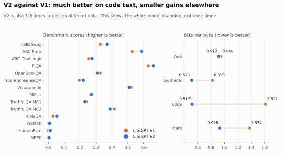
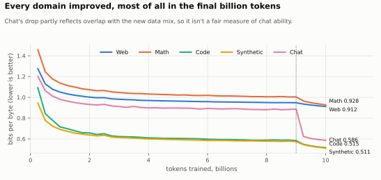

# LiteGPT

**A small language model built from scratch, with every step on record.**

LiteGPT V2 is a 201M-parameter model with its own architecture implementation, its own trained tokenizer and its own weights. It was designed on a laptop and pretrained in 37 hours on a single rented GPU. Every experiment was registered before it ran, and every result is published with the run records behind it.

| Model | What it is |
|---|---|
| [LiteGPT-V2-Base](https://huggingface.co/kmkrworks/LiteGPT-V2-Base) | The pretrained model, 4,096-token context |
| [LiteGPT-Llama-V2-Instruct](https://huggingface.co/kmkrworks/LiteGPT-Llama-V2-Instruct) | The chat version |

## Highlights

- **A modern architecture, implemented from scratch:** RoPE, RMSNorm with QK-norm, SwiGLU and grouped-query attention, 28 layers × 768.
- **Its own tokenizer:** a 32,768-token byte-level BPE, trained on the project's own data mix.
- **A big step up from V1:** clearly better on five benchmarks and clearly worse on none. On code text it is about three times better (bits per byte 1.612 → 0.515).
- **Strong code modelling for its size:** the lowest code bits per byte of every model under 300M parameters we measured.
- **Light to run:** 0.59 GiB of GPU memory at batch 8 with its own engine, the lowest of the 11 base models we measured, and 1.66 GiB of RAM on CPU.
- **Good at structured output once fine-tuned:** 91.4% accuracy on Banking77 intents, and valid JSON on 99.99% of MASSIVE requests.
- **Easy to use:** loads in Hugging Face Transformers with no remote code, and ships with an offline Python API and command line.
- **Open and on record:** every dataset revision, threshold, decision and result is in the repository, with 32 charts generated from the run records.





## How it compares

V2 doesn't reach the top score in these comparisons. What it brings is the combination above: a model built entirely from scratch, light enough for a laptop, and open down to every run record.

**Text-to-data, after fine-tuning each model the same way** (mean of 3 seeds, higher is better):

| Model | Parameters | Score | Banking77 | MASSIVE | CUAD | Peak RAM on CPU |
|---|---:|---:|---:|---:|---:|---:|
| Qwen3-0.6B | 596M | 0.851 | 0.931 | 0.812 | 0.809 | 4.27 GiB |
| Gemma 3 270M | 268M | 0.822 | 0.919 | 0.778 | 0.768 | 2.62 GiB |
| SmolLM2-135M | 135M | 0.817 | 0.920 | 0.787 | 0.745 | 1.61 GiB |
| **LiteGPT V2** | **201M** | **0.800** | **0.914** | **0.775** | **0.711** | **1.66 GiB** |

**As a base model** (higher is better, except bits per byte and memory):

| Model | Zero-shot mean, 10 tasks | Code bits per byte | GPU memory, batch 8 |
|---|---:|---:|---:|
| Qwen3-0.6B-Base | 0.489 | 0.372 | 2.72 GiB |
| SmolLM2-135M | 0.403 | 0.559 | 0.73 GiB |
| Gemma 3 270M | 0.393 | 0.617 | 2.59 GiB |
| **LiteGPT V2** | **0.383** | **0.515** | **0.59 GiB** |
| LiteGPT V1 | 0.371 | 1.612 | 0.78 GiB |

**As a chat model** (IFEval, higher is better): Qwen3-0.6B 0.564, Gemma 3 270M-it 0.251, SmolLM2-135M-Instruct 0.220, **LiteGPT V2 Instruct 0.129**, LiteGPT V1 Instruct 0.083.

V2's memory figures use its own engine and the others use Transformers. Every model, every task and the charts: [docs/results.md](docs/results.md).

## Use it

With Transformers:

```python
from transformers import AutoModelForCausalLM, AutoTokenizer

name = "kmkrworks/LiteGPT-Llama-V2-Instruct"
tokenizer = AutoTokenizer.from_pretrained(name)
model = AutoModelForCausalLM.from_pretrained(name)
inputs = tokenizer.apply_chat_template([{"role": "user", "content": "Name three colours."}], add_generation_prompt=True, return_tensors="pt", return_dict=True)
output = model.generate(**inputs, max_new_tokens=48)
print(tokenizer.decode(output[0, inputs["input_ids"].shape[1]:], skip_special_tokens=True))
```

With LiteGPT's own engine, from this repository (Python 3.12, [uv](https://docs.astral.sh/uv/)), after downloading a model folder:

```bash
uv sync --locked
```

```bash
uv run litegpt chat --model LiteGPT-Llama-V2-Instruct
```

```python
import litegpt

m = litegpt.load("LiteGPT-V2-Base")
print(litegpt.generate(m, "The capital of France is", max_new_tokens=32))
```

Once downloaded, everything runs offline. More in [docs/inference.md](docs/inference.md).

## How it was built

| Stage | What happened |
|---|---|
| Design | Each architecture change tested one at a time on small proxy models |
| Data | Web, synthetic textbooks, math and code, with benchmark text filtered out and licences audited |
| Pretraining | 37 hours on one rented A100, with no restarts and no skipped steps, for $16.64 |
| Chat fine-tuning | 3 epochs on curated conversations, passing its registered quality gate |
| Evaluation | One suite for V2 and 16 other models, plus a fine-tuned text-to-data benchmark |

The full story is in [docs/history.md](docs/history.md), every benchmark is in [docs/results.md](docs/results.md), and every chart is in [docs/figures](docs/figures/README.md).

## What's here

| Folder | What it holds |
|---|---|
| [`litegpt/`](litegpt/README.md) | The package: model, tokenizer, inference, training, evaluation, export, API and CLI |
| [`docs/`](docs/README.md) | Results, charts, history, architecture, data, licences, decisions and the experiment registry |
| [`benchmarks/`](benchmarks/README.md) | Run configs and benchmark tools |
| [`scripts/`](scripts/README.md) | Data preparation, training, scoring, release and rented-server tools |
| [`tests/`](tests/README.md) | The test suite |
| [`runs/`](runs/README.md) | Run records behind every reported number |

## V1

V1 is GPT-2 Small (124M), trained on FineWeb-Edu and fine-tuned on Alpaca, published as `koganrath/LiteGPT-Base` and `koganrath/LiteGPT-Instruct`. Its code is preserved in [`scripts/legacy_v1/`](scripts/legacy_v1/README.md).

## Licence

Code: MIT ([`LICENSE`](LICENSE)). Weights: Apache-2.0, each model with its own notice file ([ADR-011](docs/decisions/ADR-011-model-licence.md)). Datasets and their terms: [docs/data_licenses.md](docs/data_licenses.md).

## Acknowledgements

- [PyTorch](https://pytorch.org), [flash-attn](https://github.com/Dao-AILab/flash-attention), Hugging Face [`tokenizers`](https://github.com/huggingface/tokenizers) and [`transformers`](https://github.com/huggingface/transformers), and [lm-evaluation-harness](https://github.com/EleutherAI/lm-evaluation-harness)
- [nanoGPT](https://github.com/karpathy/nanoGPT) by Andrej Karpathy, the starting point for V1's initial design
- [SmolLM corpus, FineMath and SmolTalk](https://huggingface.co/HuggingFaceTB) by Hugging Face
- [github-code-clean](https://huggingface.co/datasets/codeparrot/github-code-clean) by CodeParrot
- [CUAD](https://huggingface.co/datasets/theatticusproject/cuad), [MASSIVE](https://huggingface.co/datasets/AmazonScience/massive), [Banking77](https://huggingface.co/datasets/PolyAI/banking77) and [BillSum](https://huggingface.co/datasets/FiscalNote/billsum)

**Built with Qwen. Built with Llama.** The models were trained in part on data generated by Qwen2.5-72B-Instruct, and the chat model on data generated by Llama-3.1-405B-Instruct. See each model's notice file.
