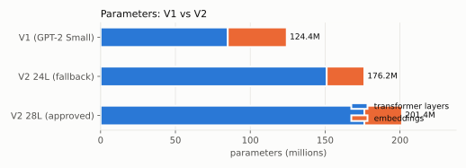

# LiteGPT V2 architecture

Source of truth: [`docs/spec/v2.yaml`](spec/v2.yaml) and [ADR-005](decisions/ADR-005-model-architecture.md).
Implementation: [`litegpt/model.py`](../litegpt/model.py) (single file, architecture only), configs in
[`litegpt/config.py`](../litegpt/config.py). Generated parameter / FLOP tables: [`runs/report-latest/REPORT.md`](../runs/report-latest/REPORT.md).

| Component | V2 |
|---|---|
| Layout | decoder-only, pre-norm residual blocks, tied input/output embeddings, no biases |
| Shape | 28 layers x d_model 768, 12 query heads / 4 KV heads (GQA 3:1), head_dim 64 |
| Positions | RoPE (rotate-half layout), theta 10,000, kept at 4,096 context ([ADR-009](decisions/ADR-009-m3-cloud-budget-context-and-mixture.md)) |
| Norm | RMSNorm (eps 1e-6) + per-head QK-norm applied before RoPE |
| FFN | SwiGLU, hidden 2048 |
| Vocabulary / context | 32,768 (byte-level BPE, trained on our data with Hugging Face `tokenizers`) / 4,096 (2,048 until the last pretraining phase) |
| Init | N(0, 0.02); `o_proj` and `down_proj` scaled by 1/sqrt(2 * n_layer) |

## Attention backends

PyTorch SDPA is mandatory and always available. flash-attn is optional and was adopted for `attention_backend: auto` after
passing the pre-registered parity and speed rule (+12% tokens/s, [ADR-006](decisions/ADR-006-toolchain-oct-2026.md)): `auto`
uses flash only when it is installed, tensors are on CUDA in bf16/fp16 and no KV cache is used, otherwise SDPA.
`sdpa` / `flash` force a backend. Packed sequences (`cu_seqlens`) work on both: SDPA builds a
block-diagonal causal mask, flash uses its varlen kernel; RoPE positions restart per document either way.

## Hugging Face compatibility

Module and parameter names mirror `Qwen3ForCausalLM` (`model.embed_tokens`, `model.layers.N.self_attn.{q,k,v,o}_proj`,
`q_norm`, `k_norm`, `mlp.{gate,up,down}_proj`, `input_layernorm`, `post_attention_layernorm`, `model.norm`, `lm_head`) so export is
a tensor copy plus a config. The implementation is our own. The logit-parity test arrives with the export and is not built yet ([distribution](distribution.md)).

## KV cache

`KVCache` preallocates `[n_layer, B, n_kv_head, max_len, head_dim]`. `forward(idx, kv_cache=...)` handles prefill, chunked
continuation and single-token decode; tests assert incremental decoding equals a full forward pass.

## Size

