# Figures

Generated from the run records by `python -m scripts.build_figures`. Don't edit by hand. V2 is always blue and V1 always orange. The tables behind most charts are in [results.md](../results.md).

## Text-to-data comparison

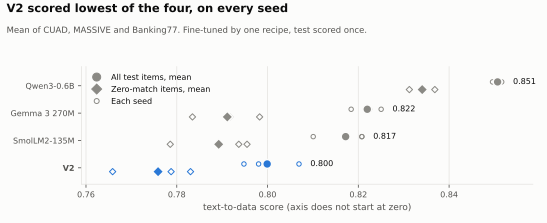

*Mean of CUAD, MASSIVE and Banking77. Fine-tuned by one recipe, test scored once.* Source: `runs/m4_t2d/test_results.json`.

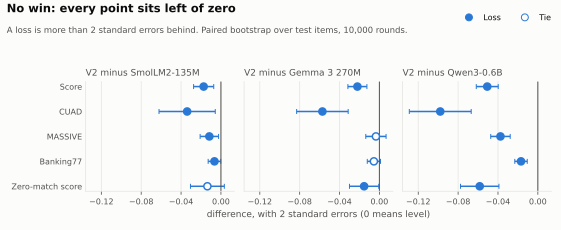

*A loss is more than 2 standard errors behind. Paired bootstrap over test items, 10,000 rounds.* Source: `runs/m4_t2d/test_results.json`.

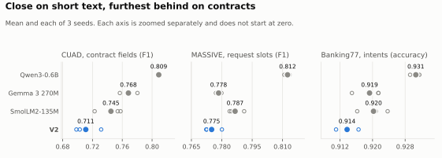

*Mean and each of 3 seeds. Each axis is zoomed separately and does not start at zero.* Source: `runs/m4_t2d/test_results.json`.

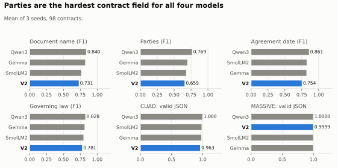

*Mean of 3 seeds, 98 contracts.* Source: `runs/m4_t2d/test_results.json`.

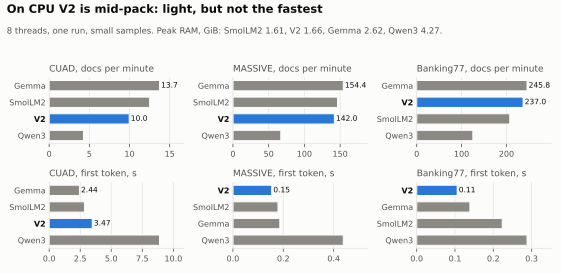

*8 threads, one run, small samples. Peak RAM, GiB: SmolLM2 1.61, V2 1.66, Gemma 2.62, Qwen3 4.27.* Source: `runs/m4_t2d/cpu-*.json`.

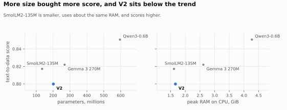

*SmolLM2-135M is smaller, uses about the same RAM, and scores higher.* Source: `runs/m4_t2d/test_results.json, cpu-*.json`.

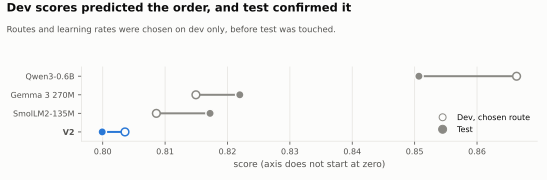

*Routes and learning rates were chosen on dev only, before test was touched.* Source: `runs/m4_t2d/routes.json, test_results.json`.

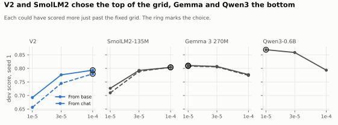

*Each could have scored more just past the fixed grid. The ring marks the choice.* Source: `runs/m4_t2d/lr_choices.json`.

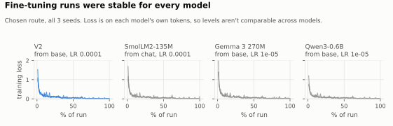

*Chosen route, all 3 seeds. Loss is on each model's own tokens, so levels aren't comparable across models.* Source: `runs/*-train-m4-t2d-*/metrics.jsonl`.

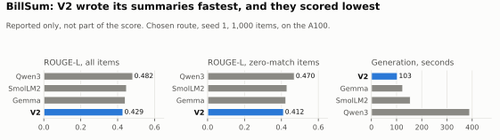

*Reported only, not part of the score. Chosen route, seed 1, 1,000 items, on the A100.* Source: `runs/m4_t2d/billsum-*.json`.

## Base models

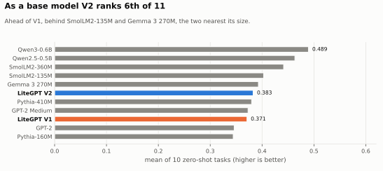

*Ahead of V1, behind SmolLM2-135M and Gemma 3 270M, the two nearest its size.* Source: `runs/*-eval-base-*/eval/summary.json`.

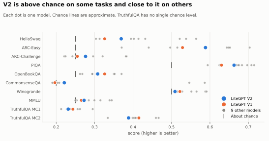

*Each dot is one model. Chance lines are approximate. TruthfulQA has no single chance level.* Source: `runs/*-eval-base-*/eval/summary.json`.

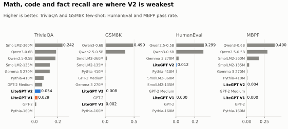

*Higher is better. TriviaQA and GSM8K few-shot; HumanEval and MBPP pass rate.* Source: `runs/*-eval-base-*/eval/summary.json`.

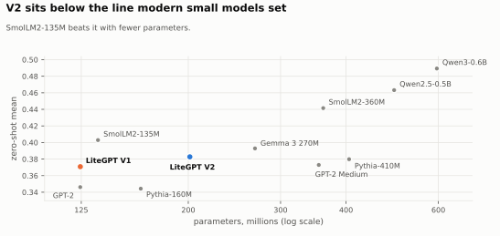

*SmolLM2-135M beats it with fewer parameters.* Source: `runs/*-eval-base-*, runs/*-eval-efficiency-*`.

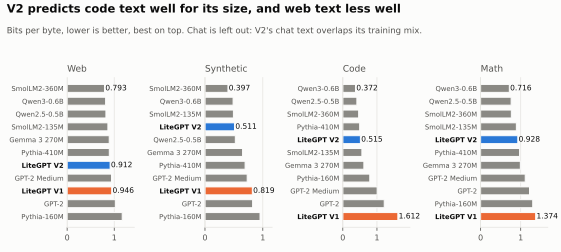

*Bits per byte, lower is better, best on top. Chat is left out: V2's chat text overlaps its training mix.* Source: `runs/*-eval-bpb-*/eval/bpb.json`.

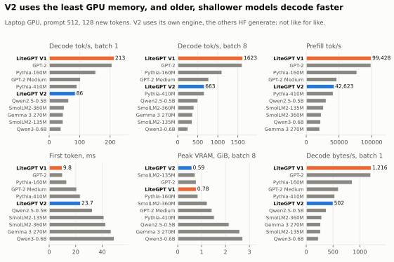

*Laptop GPU, prompt 512, 128 new tokens. V2 uses its own engine, the others HF generate: not like for like.* Source: `runs/*-eval-efficiency-*/eval/efficiency.json`.

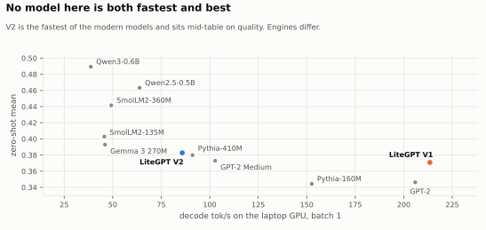

*V2 is the fastest of the modern models and sits mid-table on quality. Engines differ.* Source: `runs/*-eval-efficiency-*, runs/*-eval-base-*`.

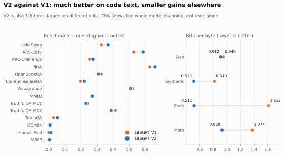

*V2 is also 1.6 times larger, on different data. This shows the whole model changing, not code alone.* Source: `runs/*-eval-base-*, runs/*-eval-bpb-*`.

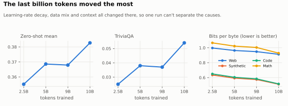

*Learning-rate decay, data mix and context all changed there, so one run can't separate the causes.* Source: `runs/*-eval-base-litegpt-*, runs/*-eval-bpb-litegpt-*`.

## CPU and Raspberry Pi

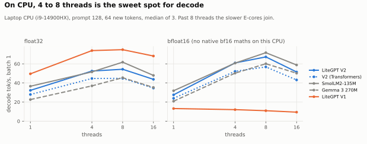

*Laptop CPU (i9-14900HX), prompt 128, 64 new tokens, median of 3. Past 8 threads the slower E-cores join.* Source: `runs/*-bench-cpu-*/bench/cpu.json`.

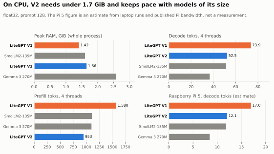

*float32, prompt 128. The Pi 5 figure is an estimate from laptop runs and published Pi bandwidth, not a measurement.* Source: `runs/*-bench-cpu-*/bench/`.

## Chat models

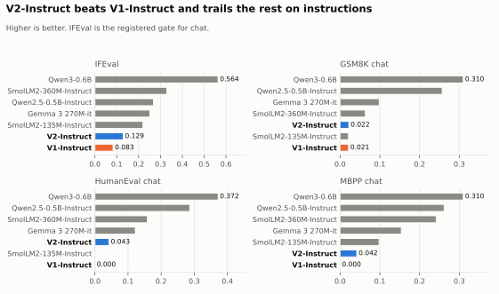

*Higher is better. IFEval is the registered gate for chat.* Source: `runs/*-eval-instruct-*/eval/summary.json`.

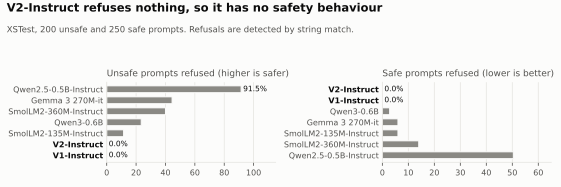

*XSTest, 200 unsafe and 250 safe prompts. Refusals are detected by string match.* Source: `runs/*-eval-xstest-*/eval/xstest.json`.

## Training

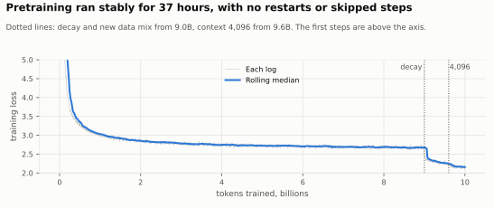

*Dotted lines: decay and new data mix from 9.0B, context 4,096 from 9.6B. The first steps are above the axis.* Source: `20261101T142254Z-train-m3-673cd85/metrics.jsonl`.

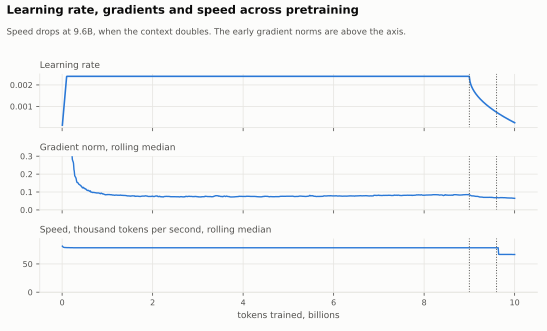

*Speed drops at 9.6B, when the context doubles. The early gradient norms are above the axis.* Source: `20261101T142254Z-train-m3-673cd85/metrics.jsonl`.

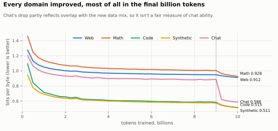

*Chat's drop partly reflects overlap with the new data mix, so it isn't a fair measure of chat ability.* Source: `20261101T142254Z-train-m3-673cd85/eval.jsonl`.

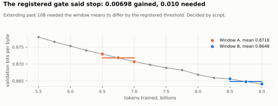

*Extending past 10B needed the window means to differ by the registered threshold. Decided by script.* Source: `20261101T142254Z-train-m3-673cd85/gate/extension_gate.json`.

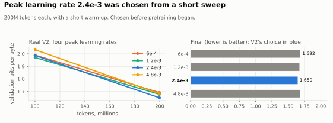

*200M tokens each, with a short warm-up. Chosen before pretraining began.* Source: `runs/*-train-m3lr-*/eval.jsonl`.

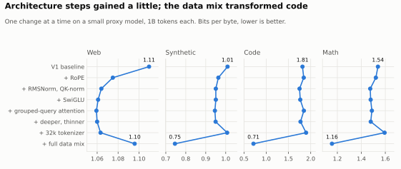

*One change at a time on a small proxy model, 1B tokens each. Bits per byte, lower is better.* Source: `runs/*-train-ladder-*/eval.jsonl`.

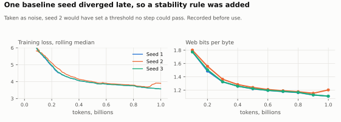

*Taken as noise, seed 2 would have set a threshold no step could pass. Recorded before use.* Source: `runs/*-train-ladder-s1-*`.

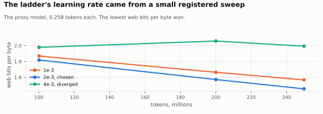

*The proxy model, 0.25B tokens each. The lowest web bits per byte won.* Source: `runs/*-train-ladder-lrsweep-*`.

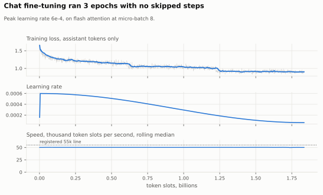

*Peak learning rate 6e-4, on flash attention at micro-batch 8.* Source: `20261103T144735Z-train-m4-sft-0034095/metrics.jsonl`.

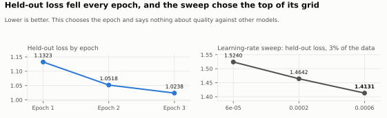

*Lower is better. This chooses the epoch and says nothing about quality against other models.* Source: `20261103T144735Z-train-m4-sft-0034095/train_summary.json`.

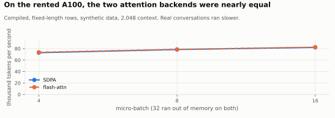

*Compiled, fixed-length rows, synthetic data, 2,048 context. Real conversations ran slower.* Source: `20261101T140558Z-bench-tune-throughput-5f34d96`.
