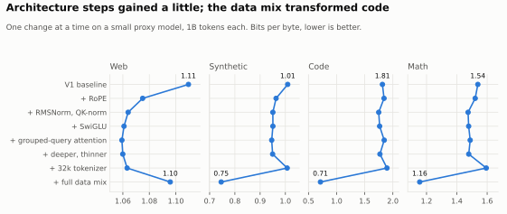
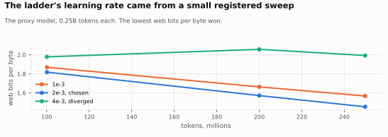
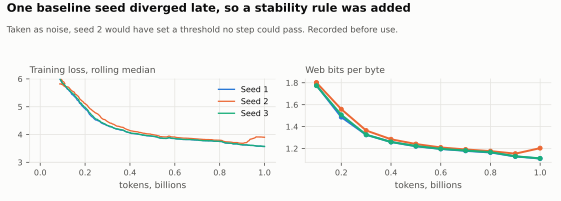
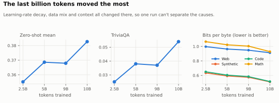

# How V2 was built

The stages, the decisions that shaped the model, and what went wrong. Detail: [experiment registry](spec/registry.yaml), [ADRs](decisions/README.md), and the [run records](../runs/README.md). Final numbers: [results.md](results.md).

## Working method

Every experiment was registered, with its thresholds, before it ran. The owner approved each phase. Corrections were recorded before acting on them. A recipe change after seeing test scores would void a comparison and be recorded as a deviation. Results are published whichever way they went.

## Scope

Replace the nanoGPT base of V1 with a training pipeline built entirely in-house, train a model end to end with it, and learn what that takes. Topping benchmarks was not the goal.

## Stages

| Stage | Date | What it did | Outcome |
|---|---|---|---|
| **Foundations** | Oct 2026 | Environment, model code, run records, GPU benchmarks | Model code and tooling in place |
| **Data and tokenizer** | Oct 2026 | Licence audit, data preparation, own 32k tokenizer, benchmark text filtered from training data | 20.79B tokens prepared |
| **Baselines** | Oct 2026 | Evaluation suite, 16 models scored before V2 existed | Targets known before training |
| **Design experiments** | Oct to Nov 2026 | Small proxy models on the laptop GPU, one design change per step; learning-rate sweep on the real V2 | Design and learning rate 2.4e-3 chosen |
| **Pretraining** | Nov 1 to 3, 2026 | The real V2 on one rented A100 | 10.0B tokens, 37.2 h. Better than V1, behind SmolLM2-135M and Gemma 3 270M |
| **Chat and comparison** | Nov 3 to 5, 2026 | Chat fine-tuning, registered text-to-data comparison, API and CLI | Chat gate passed. **Comparison lost** |
| **Release** | Nov 2026 | Licence decision, export, model cards, this clean-up | Models published; release to be marked |

## The design ladder

Each step changed one thing on a small proxy model, 1B tokens each. Web bits per byte, lower is better:

| Step | Change | Web | Code |
|---|---|---:|---:|
| s1 | V1 baseline (mean of two stable seeds) | 1.1096 | 1.8147 |
| s2 | + RoPE | 1.0750 | 1.8433 |
| s3 | + RMSNorm and QK-norm | 1.0640 | 1.7490 |
| s4 | + SwiGLU | 1.0609 | 1.7652 |
| s5 | + grouped-query attention | 1.0593 | 1.8463 |
| s6 | + deeper and thinner | 1.0599 | 1.7704 |
| s7 | + 32k tokenizer | 1.0632 | 1.8957 |
| s8a | + full data mixture | 1.0958 | 0.7123 |

s7 and s8a were labelled "hurts" on web by the registered rule. The owner kept both: the mixture cut code bits per byte by more than half, and web was not the only goal.

## Decisions that shaped the model

| Decision | Choice | Why | Record |
|---|---|---|---|
| Architecture | RoPE, RMSNorm with QK-norm, SwiGLU, GQA, 28 x 768 | Modern parts tested one at a time | [ADR-005](decisions/ADR-005-model-architecture.md) |
| Licensing of data | No Wikipedia; only permissive-labelled code; Apache-2.0-labelled SmolTalk subsets | Avoid share-alike and ambiguous terms | [register](data_licenses.md) |
| Benchmark overlap | Remove training documents sharing a 13-word run with evaluation sets | Scores should not reflect memorised test text | EXP-M1-DECONTAM |
| Length | 10B tokens, more only through a registered gate | Decide extension from evidence, not hope | [ADR-001](decisions/ADR-001-compute-budget-and-extension-gate.md) |
| Compute | Design experiments on the RTX 4090 Laptop GPU; pretraining and chat fine-tuning on one rented A100 | Days of continuous full load shorten a mobile GPU's life. The laptop could still do it, in about four days (*estimate*) | [ADR-009](decisions/ADR-009-m3-cloud-budget-context-and-mixture.md) |
| Purpose | Private, offline text-to-data | The owner's use case. Judge by results, not by how little data was used | [ADR-009](decisions/ADR-009-m3-cloud-budget-context-and-mixture.md), [ADR-010](decisions/ADR-010-m4-scope-text-to-data-comparison-and-cloud.md) |
| Scope of the chat stage | Chat fine-tuning and a real comparison; reasoning and preference tuning deferred | A comparison tells us more than more stages | [ADR-010](decisions/ADR-010-m4-scope-text-to-data-comparison-and-cloud.md) |
| Autonomy | The chat and comparison stage ran without owner stops; registered rules decided | Owner's choice, made before any G2 or test result | EXP-M4-SFT |
| After the loss | No plan for more tokens or longer training | Owner's decision. What comes next is open | This page |
| Release | `LiteGPT-V2-Base` and `LiteGPT-Llama-V2-Instruct` | Owner's decision. The Llama licence asks for the word at the start of the name | [ADR-011](decisions/ADR-011-model-licence.md) |
| Repository | Development history squashed for release | Owner's decision; also removes personal paths from history | [runs/README.md](../runs/README.md) |

## Recorded deviations

- **Laptop thermal rule:** runs were throttled 95 to 98% of the time, breaking the registered 5% limit. A power profile fixed it; the affected work was handled by a recorded owner decision.
- **Design-experiment noise floor:** s1 seed 2 diverged during decay. Taken at face value, it would have set a threshold no step could pass. A divergence rule and a third seed were added, recorded before use.
- **Chat fine-tuning speed check:** real packed steps ran at 46.7k tokens per second, under the registered 55k stop. The owner chose to continue on flash attention.
- **Chat evaluation machine:** G2 was measured on the A100, its baselines on the laptop. A later laptop run differed by one question of 541.
- **Instruct name:** "Llama" is in the name but not at the start: see [ADR-011](decisions/ADR-011-model-licence.md).

## What went wrong

| When | What | Result |
|---|---|---|
| Design experiments | First smoke run filled GPU memory and spilled into shared memory: no step in 4 minutes | Memory cap and probe added |
| Design experiments | Final evaluations ran out of memory at the last step | Fixed and resumed |
| Design experiments | WSL updated itself and restarted mid-run; Windows Update rebooted the laptop twice; a charger came loose and the laptop slept | Resumed from checkpoints, worst loss about 10 minutes |
| Pretraining | First start crashed on an index too short; "too many open files" | Fixed; the failed run is kept |
| Pretraining | The guard backed up only the newest checkpoints, so milestones were on the server alone | Found in time; all uploaded and verified |
| Chat and comparison | Fine-tunes first ran at 224 tokens per second: GPU memory spill | Memory cap added |
| Chat and comparison | The A100 was no faster than the laptop on generation | Registered rule moved test scoring to the laptop |
| Chat and comparison | The backup list missed G2's evaluation run, and the A100 was then rented out | Recovered from the volume by a cheap second server. Backup fixed |
| Chat and comparison | Test scoring died 5 minutes in and went unnoticed for a day | Resumed from saved outputs. Nothing had been scored |
| Release | Safe checkpoint loading refused real training checkpoints | Caught only by testing real weights. Tests now cover it |
| Release | My first export check compared rounded RoPE tables by mistake | Caught on a tiny model and corrected in the registry before any real export |

## The laptop GPU

The design experiments ran on an RTX 4090 Laptop GPU. They needed WSL2 with `torch.compile` and flash attention, and a tuned power profile that removed thermal throttling. The details are in the [README](../README.md#built-on-a-laptop-gpu).

## What the project concluded

1. The full pipeline works end to end without nanoGPT: data, tokenizer, model, training, evaluation, export.
2. V2 improved on V1 at general tasks, chat and code tasks.
3. V2 doesn't top the comparisons with SmolLM2-135M and Gemma 3 270M, which was never the aim.
4. Its strength is the record: this page, the registry and the runs.

## Not done

- No one has rebuilt the model independently.
- Reasoning and preference tuning were not attempted.
- Spider and MultiPL-E evaluations were not run.
- Safety work: none. V2-Instruct refuses nothing.
