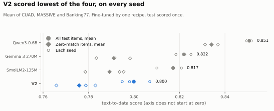
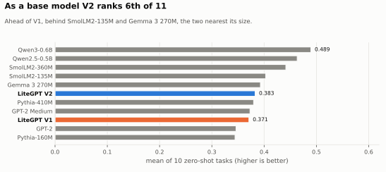

# LiteGPT V2 Base (draft model card, not released)

> Draft for owner review. Not released yet.

**Built with Qwen.** See Training data.

A 201M-parameter language model trained from scratch, with its build on record: every dataset revision, threshold and result, including the comparison it lost.

## Should you use it?

- **For extracting data from text: no.** In our registered comparison it lost to SmolLM2-135M, Gemma 3 270M and Qwen3-0.6B. Use one of those. [Full results](../results.md).
- **For math or code: no.** GSM8K 0.008, HumanEval 2 of 164 problems, MBPP 0.004.
- **For chat: no.** This is a base model: it continues text and has no chat or safety training. LiteGPT-Llama-V2-Instruct is the [chat version](model_card_instruct.md), and it is weak too.
- **For studying how a small model is built and tested: yes.** That is what this release is for.

## Results





| Text-to-data, after fine-tuning | V2 | SmolLM2-135M | Gemma 3 270M | Qwen3-0.6B |
|---|---:|---:|---:|---:|
| Score (higher is better) | 0.800 | 0.817 | 0.822 | 0.851 |
| Verdict for V2 | | Loss | Loss | Loss |
| Peak RAM on CPU, GiB | 1.66 | 1.61 | 2.62 | 4.27 |

| Base suite | V2 | V1 | SmolLM2-135M | Gemma 3 270M |
|---|---:|---:|---:|---:|
| Zero-shot mean (10 tasks) | 0.383 | 0.371 | 0.403 | 0.393 |
| TriviaQA | 0.054 | 0.029 | 0.134 | 0.133 |

V1 has 124.5M parameters, SmolLM2-135M 134.5M, Gemma 3 270M 268.1M. Scores are ours, on one laptop, under thresholds registered before measuring.

## Model

| Item | Value |
|---|---|
| Parameters | 201,373,952 |
| Shape | 28 layers, 768 wide, 12 heads, 4 KV heads |
| Parts | RoPE, RMSNorm, QK-norm, SwiGLU, grouped-query attention |
| Context | 4,096 tokens |
| Tokenizer | 32,768-token byte-level BPE, trained on our data with Hugging Face `tokenizers` |

## Use

With Transformers (no remote code needed):

```python
from transformers import AutoModelForCausalLM, AutoTokenizer

name = "kmkrworks/LiteGPT-V2-Base"
tokenizer = AutoTokenizer.from_pretrained(name)
model = AutoModelForCausalLM.from_pretrained(name)
inputs = tokenizer("The capital of France is", return_tensors="pt")
print(tokenizer.decode(model.generate(**inputs, max_new_tokens=32)[0], skip_special_tokens=True))
```

With LiteGPT's own engine, from a [clone of the repository](https://github.com/kmkrofficial/LiteGPT):

```text
uv sync --locked
uv run litegpt generate --model LiteGPT-V2-Base "The capital of France is"
```

## Transformers and LiteGPT

The weights load exactly: in float32, both give identical logits and greedy output. Two differences remain:

- **At the default bfloat16, numbers differ slightly**, because Transformers computes RMSNorm in float32 and LiteGPT in bfloat16, so outputs can part ways. Our benchmarks used LiteGPT's engine.
- **Literal control tokens:** through Transformers, text containing `<|im_end|>` or similar is read as a control token. LiteGPT reads it as plain text. Clean untrusted input if you use Transformers.

## Training data

10.0B tokens, on one rented A100, in 37.2 hours. Mixture and exact revisions: [`data_sources.yaml`](../spec/data_sources.yaml). Licences: [`data_licenses.md`](../data_licenses.md).

| Source | Licence | Main phase | Decay phase |
|---|---|---:|---:|
| FineWeb-Edu | ODC-By 1.0, Common Crawl terms | 72% | 50% |
| Cosmopedia v2 (generated by Mixtral-8x7B-Instruct) | ODC-By 1.0 | 13% | 20% |
| FineMath | ODC-By 1.0, Common Crawl terms | 7.5% | 13% |
| Code: Python, JS, TS, SQL, Shell from github-code-clean | Permissive repository labels | 7.5% | 12% |
| SmolTalk summarize, rewrite, constraints (generated by Qwen2.5-72B-Instruct) | Apache-2.0 per card, Qwen licence on the generator | 0% | 5% |

Contains information from FineWeb-Edu, Cosmopedia v2 and FineMath, which are made available under the [ODC Attribution License](https://opendatacommons.org/licenses/by/1-0/).

Wikipedia was excluded. Code licence labels are repository-level, not a per-file audit, and the attributions of individual files are not reproduced.

## Limits

- It has not been tested for safety, and it has had no safety training.
- It can produce false, biased or offensive text. It was trained on web text.
- Its strongest measured lead is in low GPU memory on our own engine, which is not a like-for-like comparison.
- No one has rebuilt this model independently. The recipe is on record and re-runnable.

## Licence

Apache-2.0 for the weights, MIT for the code, with the [NOTICE](NOTICE.txt) file ([ADR-011](../decisions/ADR-011-model-licence.md)).
