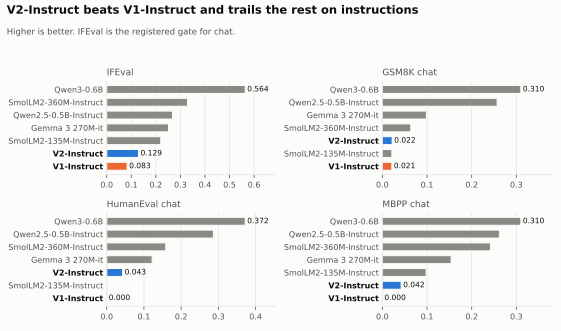
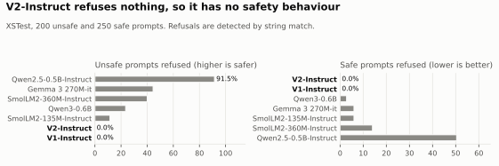

# LiteGPT-Llama-V2-Instruct

**Built with Llama. Built with Qwen.** See Training data.

LiteGPT V2 after chat fine-tuning, called V2-Instruct in our results. It follows instructions better than V1-Instruct, and it has no safety behaviour.

## Should you use it?

- **Anywhere people will read its output unsupervised: no.** It refused 0% of XSTest's unsafe prompts.
- **For following instructions: there are better free models.** SmolLM2-135M-Instruct and Gemma 3 270M-it score well above it.
- **For facts, math or code: no.** See Results. It can state false things confidently.
- **For extracting data from text: no.** Fine-tuning from the base model scored higher, and that still lost: [results](../results.md).
- **For studying chat fine-tuning on a small model: yes.** That is what this release is for.

## Results





Higher is better, except safe prompts refused.

| Task | V2-Instruct | V1-Instruct | SmolLM2-135M-Instruct | Gemma 3 270M-it |
|---|---:|---:|---:|---:|
| IFEval | 0.129 | 0.083 | 0.220 | 0.251 |
| GSM8K chat | 0.022 | 0.021 | 0.021 | 0.099 |
| HumanEval chat | 0.043 | 0.000 | 0.000 | 0.122 |
| MBPP chat | 0.042 | 0.000 | 0.098 | 0.154 |
| XSTest unsafe prompts refused | 0% | 0% | 11.5% | 44.5% |
| XSTest safe prompts refused | 0% | 0% | 6.0% | 6.0% |

It passed its registered gate: IFEval above V1-Instruct by more than 2 standard errors (0.1312 and 2.56 standard errors on the A100; 0.1294 on the laptop, one question lower).

## Model

| Item | Value |
|---|---|
| Parameters | 201,373,952 |
| Started from | LiteGPT V2 Base, M3 final |
| Context | 4,096 tokens |
| Chat format | [`litegpt-chat-v1`](../chat_template.md) |

## Use

With Transformers (no remote code needed):

```python
from transformers import AutoModelForCausalLM, AutoTokenizer

name = "kmkrworks/LiteGPT-Llama-V2-Instruct"
tokenizer = AutoTokenizer.from_pretrained(name)
model = AutoModelForCausalLM.from_pretrained(name)
inputs = tokenizer.apply_chat_template([{"role": "user", "content": "What is the capital of France?"}], add_generation_prompt=True, return_tensors="pt", return_dict=True)
output = model.generate(**inputs, max_new_tokens=48)
print(tokenizer.decode(output[0, inputs["input_ids"].shape[1]:], skip_special_tokens=True))
```

With LiteGPT's own engine, from a [clone of the repository](https://github.com/kmkrofficial/LiteGPT):

```text
uv sync --locked
uv run litegpt chat --model LiteGPT-Llama-V2-Instruct
```

Benchmarks were scored through LiteGPT's engine, and at bfloat16 Transformers can differ from it slightly.

## Training

3 epochs, 14,000 steps, assistant-only loss, peak learning rate 6e-4. Held-out loss 1.1323, 1.0518, 1.0238. Details: [training.md](../training.md).

## Training data

Everything in the [Base card](model_card_base.md), then these chat conversations (385,677 in all, 497M tokens). Licences: [`data_licenses.md`](../data_licenses.md).

| Source | Dataset card | Generated by |
|---|---|---|
| smol-magpie-ultra | Apache-2.0 | Llama-3.1-405B-Instruct |
| smol-summarize, smol-rewrite, smol-constraints (reserved part) | Apache-2.0 | Qwen2.5-72B-Instruct |

Llama 3.1 is licensed under the Llama 3.1 Community License, Copyright © Meta Platforms, Inc. All Rights Reserved. Use of this model should follow the [Llama Acceptable Use Policy](https://llama.meta.com/llama3_1/use-policy).

**On the name:** this model trained on Llama outputs, so its name includes "Llama". The licence asks for the word at the beginning of the name. See [ADR-011](../decisions/ADR-011-model-licence.md).

## Limits

- **No safety behaviour.** No safety data was used, because no cleanly licensed source was found.
- It can produce false, biased, harmful or offensive text.
- No one has rebuilt this model independently. The recipe is on record.

## Licence

Apache-2.0 for the weights, MIT for the code, with the [NOTICE](NOTICE_instruct.txt) file ([ADR-011](../decisions/ADR-011-model-licence.md)).
