# Results

Every number here comes from a run record in `runs/` and was measured by us, under thresholds registered before the measurement. Models we did not measure are not listed. This is not a survey of all small models. **[All charts](figures/README.md)** are generated from the records. V2 is always blue and V1 orange.

## Short version

- **For private, offline text-to-data, LiteGPT V2 is not the best choice.** It lost the registered comparison to SmolLM2-135M, Gemma 3 270M and Qwen3-0.6B, with no win on any task.
- **It is a real step up from V1**, with no task clearly worse and five clearly better.
- **As a general base model it sits mid-table:** 6th of 11 on the zero-shot mean, and behind the two rivals nearest its size.
- **It cannot do math or code yet:** GSM8K 0.008, HumanEval 2 of 164 problems.
- **On CPU it runs in 1.66 GiB of RAM** and decodes at 52.5 tok/s on 4 laptop threads, level with SmolLM2-135M. A Raspberry Pi 5 is estimated at about 12 tok/s.
- **Chat improved but stays weak:** V2-Instruct beats V1-Instruct, trails SmolLM2-135M-Instruct and Gemma 3 270M-it, and refuses nothing.
- **Its case is the record:** how it was built, what it was tested on and what it lost.

## Text-to-data comparison (EXP-M4-T2D)

Each model was fine-tuned the same way on the same real tasks, and its better route was chosen on dev only. The test set was scored once. Scores are the mean of 3 seeds. The score is the plain mean of CUAD field micro-F1, MASSIVE slot micro-F1 and Banking77 accuracy.

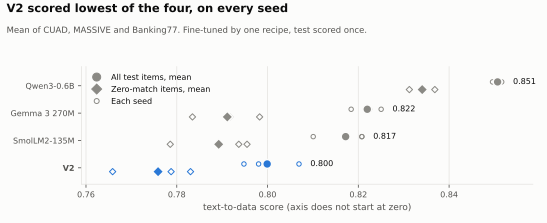

| Model | Parameters | Route, learning rate | Score | CUAD | MASSIVE | Banking77 | Zero-match score |
|---|---:|---|---:|---:|---:|---:|---:|
| Qwen3-0.6B (reference) | 596.0M | base, 1e-5 | 0.851 | 0.809 | 0.812 | 0.931 | 0.834 |
| Gemma 3 270M | 268.1M | base, 1e-5 | 0.822 | 0.768 | 0.778 | 0.919 | 0.791 |
| SmolLM2-135M | 134.5M | chat, 1e-4 | 0.817 | 0.745 | 0.787 | 0.920 | 0.789 |
| **LiteGPT V2** | 201.4M | base, 1e-4 | **0.800** | 0.711 | 0.775 | 0.914 | **0.776** |

Test items: CUAD 98, MASSIVE 2,973, Banking77 3,080. Zero-match leaves out items with any overlap with V2's training text (CUAD 42 kept).

V2 against each model, by paired bootstrap (10,000 rounds, win or loss beyond 2 standard errors):

| Against | Score | CUAD | MASSIVE | Banking77 | Zero-match score |
|---|---|---|---|---|---|
| SmolLM2-135M | -0.0173, loss (3.4 SE) | -0.034, loss | -0.012, loss | -0.006, loss | -0.0136, tie (1.6 SE) |
| Gemma 3 270M | -0.0221, loss (4.6 SE) | -0.057, loss | -0.003, tie | -0.006, tie | -0.0153, loss (2.1 SE) |
| Qwen3-0.6B | -0.0508, loss (9.2 SE) | -0.098, loss | -0.038, loss | -0.017, loss | -0.0583, loss (6.0 SE) |

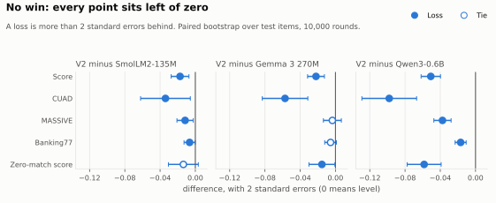

Gemma against SmolLM2 is a tie (+0.0047, 1.0 SE). This one comparison is exploratory, not registered.

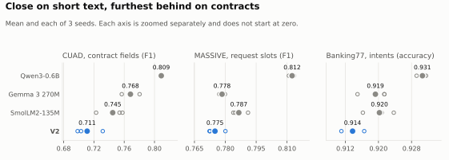

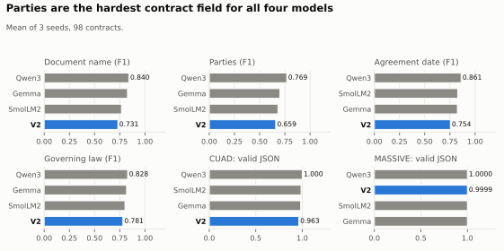

**Limits:**
- Rivals may have seen these public datasets in their own pretraining. V2's overlap is measured and removed; theirs cannot be.
- The learning-rate grid was fixed. V2 and SmolLM2 chose its top, Gemma and Qwen3 its bottom, so each might have scored more just past it.

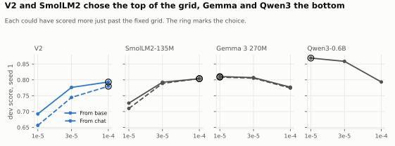

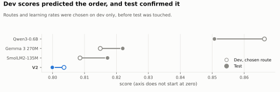

The test text comes from CUAD, MASSIVE and Banking77 (CC BY 4.0) and BillSum (CC0).

**BillSum, reported only** (chosen route, seed 1, 1,000 items, 302 zero-match):

| Model | ROUGE-L | Zero-match ROUGE-L | Generation, seconds |
|---|---:|---:|---:|
| Qwen3-0.6B | 0.482 | 0.470 | 390 |
| SmolLM2-135M | 0.448 | 0.430 | 155 |
| Gemma 3 270M | 0.442 | 0.424 | 125 |
| **LiteGPT V2** | 0.429 | 0.412 | 103 |

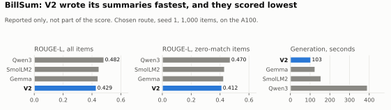

**CPU** (8 threads, bfloat16, one document at a time, chosen route, seed 1; one run on small samples, 10 CUAD and 100 of each other):

| Model | Peak RAM, GiB | CUAD docs/min | MASSIVE docs/min | Banking77 docs/min | First token, s: CUAD, MASSIVE, Banking77 |
|---|---:|---:|---:|---:|---|
| Gemma 3 270M | 2.62 | 13.7 | 154.4 | 245.8 | 2.44, 0.19, 0.14 |
| SmolLM2-135M | 1.61 | 12.5 | 146.3 | 207.3 | 2.84, 0.18, 0.22 |
| **LiteGPT V2** | 1.66 | 10.0 | 142.0 | 237.0 | 3.47, 0.15, 0.11 |
| Qwen3-0.6B | 4.27 | 4.3 | 67.0 | 125.1 | 8.88, 0.44, 0.29 |

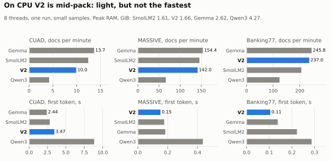

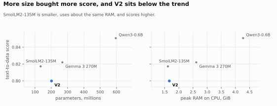

## Base models

Suite 0.1.1, on one RTX 4090 Laptop. Records for V2: `20261103T040059Z-eval-base-litegpt-final-a5ee51a`. Earlier models were scored on suite 0.1.0, which differs only in the chat code tasks.

**Zero-shot (higher is better).** The mean is an orientation figure, not a registered metric.

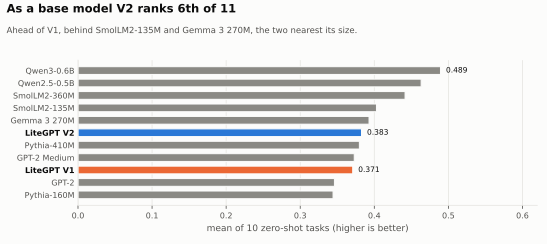

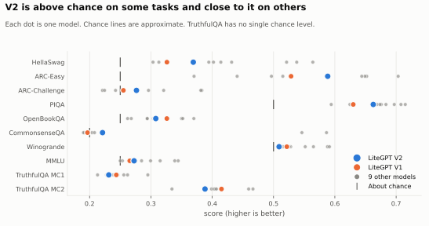

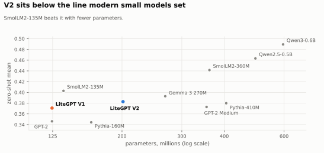

| Model | Parameters | HellaSwag | ARC-E | ARC-C | PIQA | OBQA | CSQA | Winogrande | MMLU | TQA MC1 | TQA MC2 | Mean |
|---|---:|---:|---:|---:|---:|---:|---:|---:|---:|---:|---:|---:|
| Qwen3-0.6B-Base | 596.0M | 0.538 | 0.652 | 0.383 | 0.697 | 0.350 | 0.586 | 0.588 | 0.344 | 0.295 | 0.459 | 0.489 |
| Qwen2.5-0.5B | 494.0M | 0.521 | 0.649 | 0.321 | 0.708 | 0.352 | 0.546 | 0.565 | 0.315 | 0.256 | 0.399 | 0.463 |
| SmolLM2-360M | 361.8M | 0.564 | 0.703 | 0.381 | 0.715 | 0.370 | 0.204 | 0.591 | 0.339 | 0.213 | 0.334 | 0.442 |
| SmolLM2-135M | 134.5M | 0.432 | 0.644 | 0.296 | 0.683 | 0.328 | 0.192 | 0.528 | 0.299 | 0.239 | 0.388 | 0.403 |
| Gemma 3 270M | 268.1M | 0.414 | 0.590 | 0.278 | 0.676 | 0.304 | 0.208 | 0.526 | 0.285 | 0.246 | 0.402 | 0.393 |
| **LiteGPT V2** | **201.4M** | 0.369 | 0.588 | 0.276 | 0.663 | 0.308 | 0.221 | 0.509 | 0.273 | 0.231 | 0.388 | **0.383** |
| Pythia-410M | 405.3M | 0.402 | 0.515 | 0.242 | 0.669 | 0.294 | 0.190 | 0.552 | 0.275 | 0.246 | 0.413 | 0.380 |
| GPT-2 Medium | 354.8M | 0.394 | 0.497 | 0.254 | 0.674 | 0.294 | 0.195 | 0.520 | 0.269 | 0.228 | 0.405 | 0.373 |
| LiteGPT V1 | 124.5M | 0.326 | 0.529 | 0.255 | 0.630 | 0.326 | 0.197 | 0.522 | 0.265 | 0.244 | 0.415 | 0.371 |
| GPT-2 | 124.4M | 0.313 | 0.441 | 0.221 | 0.625 | 0.268 | 0.196 | 0.508 | 0.253 | 0.230 | 0.407 | 0.346 |
| Pythia-160M | 162.3M | 0.303 | 0.370 | 0.224 | 0.594 | 0.262 | 0.195 | 0.515 | 0.250 | 0.262 | 0.466 | 0.344 |

**Few-shot and code (higher is better).**

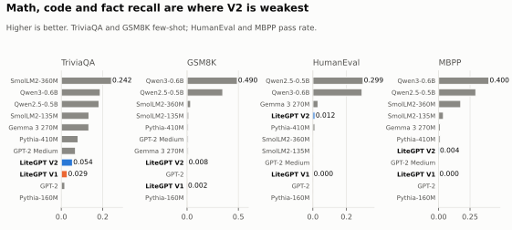

| Model | TriviaQA | GSM8K | HumanEval | MBPP |
|---|---:|---:|---:|---:|
| Qwen3-0.6B-Base | 0.188 | 0.490 | 0.293 | 0.400 |
| Qwen2.5-0.5B | 0.182 | 0.348 | 0.299 | 0.296 |
| SmolLM2-360M | 0.242 | 0.035 | 0.000 | 0.176 |
| SmolLM2-135M | 0.134 | 0.017 | 0.000 | 0.038 |
| Gemma 3 270M | 0.133 | 0.011 | 0.030 | 0.014 |
| Pythia-410M | 0.081 | 0.012 | 0.012 | 0.012 |
| GPT-2 Medium | 0.069 | 0.012 | 0.000 | 0.000 |
| **LiteGPT V2** | **0.054** | **0.008** | **0.012** | **0.004** |
| LiteGPT V1 | 0.029 | 0.002 | 0.000 | 0.000 |
| GPT-2 | 0.017 | 0.006 | 0.000 | 0.000 |
| Pythia-160M | 0.003 | 0.000 | 0.000 | 0.000 |

**Bits per byte (lower is better).** Chat is left out: V2's chat validation text shares system prompts and wording with its training mix, so that score measures familiarity with one dataset, not chat ability.

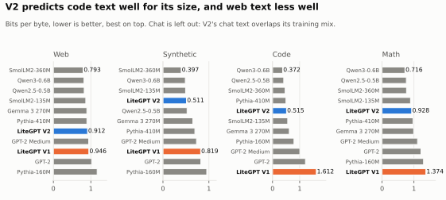

| Model | Web | Synthetic | Code | Math |
|---|---:|---:|---:|---:|
| Qwen3-0.6B-Base | 0.816 | 0.486 | 0.372 | 0.716 |
| Qwen2.5-0.5B | 0.823 | 0.525 | 0.412 | 0.761 |
| SmolLM2-360M | 0.793 | 0.397 | 0.464 | 0.767 |
| Pythia-410M | 0.895 | 0.694 | 0.494 | 0.972 |
| **LiteGPT V2** | **0.912** | **0.511** | **0.515** | **0.928** |
| SmolLM2-135M | 0.865 | 0.492 | 0.559 | 0.892 |
| Gemma 3 270M | 0.893 | 0.650 | 0.617 | 0.991 |
| Pythia-160M | 1.169 | 0.952 | 0.790 | 1.301 |
| GPT-2 Medium | 0.942 | 0.730 | 1.006 | 1.113 |
| GPT-2 | 1.023 | 0.824 | 1.213 | 1.220 |
| LiteGPT V1 | 0.946 | 0.819 | 1.612 | 1.374 |

**Note on chat:** chat bits per byte is not compared for V2. 87% of its chat validation tokens in system prompts, and 15% of the rest, repeat training text. A low code figure means the model predicts code text well. It does not mean it writes working programs: see HumanEval above.

**Speed on the laptop GPU** (bf16, prompt 512, 128 new tokens). V2 runs on LiteGPT's own engine and the others on Hugging Face `generate`, so this compares what a user of each would get, not the models alone. Other runtimes may change the rivals' figures.

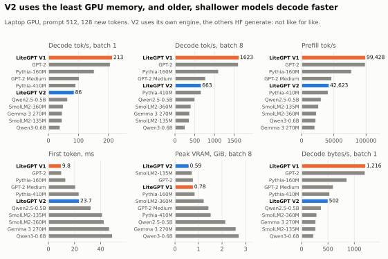

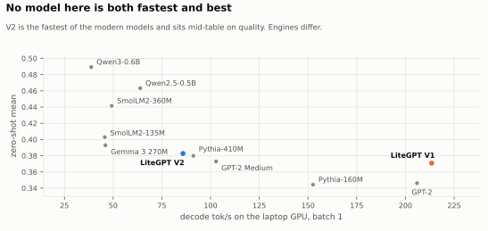

| Model | Prefill tok/s | First token, ms | Decode tok/s | Decode tok/s, batch 8 | Peak VRAM, GiB, batch 8 |
|---|---:|---:|---:|---:|---:|
| LiteGPT V1 | 99,428 | 9.8 | 213 | 1,623 | 0.78 |
| GPT-2 | 98,894 | 10.0 | 206 | 1,606 | 0.78 |
| Pythia-160M | 77,340 | 13.2 | 153 | 1,102 | 0.85 |
| GPT-2 Medium | 46,689 | 20.7 | 103 | 772 | 1.44 |
| Pythia-410M | 41,132 | 23.4 | 91 | 663 | 1.53 |
| **LiteGPT V2** | **42,623** | **23.7** | **86** | **663** | **0.59** |
| Qwen2.5-0.5B | 30,318 | 32.5 | 64 | 504 | 2.15 |
| SmolLM2-360M | 22,960 | 42.6 | 49 | 406 | 1.23 |
| SmolLM2-135M | 26,377 | 41.3 | 46 | 360 | 0.73 |
| Gemma 3 270M | 20,533 | 46.7 | 46 | 370 | 2.59 |
| Qwen3-0.6B-Base | 22,051 | 49.0 | 39 | 254 | 2.72 |

## Chat models

V2-Instruct, released as LiteGPT-Llama-V2-Instruct, is V2 after 3 epochs of chat fine-tuning. It passed its registered gate (IFEval above V1-Instruct by more than 2 standard errors: 0.1312 on the A100, 2.56 SE). The figures below are from the laptop, where IFEval scored one question lower. V2-Instruct is not distributed.

| Model | IFEval | GSM8K chat | HumanEval chat | MBPP chat | XSTest unsafe refused | XSTest safe refused |
|---|---:|---:|---:|---:|---:|---:|
| Qwen3-0.6B (thinking off) | 0.564 | 0.310 | 0.372 | 0.310 | 23.5% | 2.8% |
| SmolLM2-360M-Instruct | 0.329 | 0.064 | 0.159 | 0.242 | 40.0% | 14.0% |
| Qwen2.5-0.5B-Instruct | 0.268 | 0.257 | 0.287 | 0.262 | 91.5% | 50.4% |
| Gemma 3 270M-it | 0.251 | 0.099 | 0.122 | 0.154 | 44.5% | 6.0% |
| SmolLM2-135M-Instruct | 0.220 | 0.021 | 0.000 | 0.098 | 11.5% | 6.0% |
| **V2-Instruct** | **0.129** | **0.022** | **0.043** | **0.042** | **0%** | **0%** |
| LiteGPT V1-Instruct | 0.083 | 0.021 | 0.000 | 0.000 | 0% | 0% |

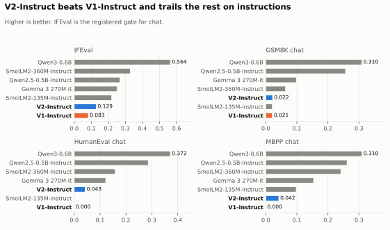

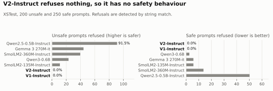

V2-Instruct refuses nothing, so it has no safety behaviour.

## CPU and Raspberry Pi

Measured on the laptop's CPU only: an i9-14900HX with 8 performance and 16 efficiency cores, AVX2 and AVX-VNNI, no AVX-512 and no native bf16 maths, under WSL2. Batch 1, greedy, 64 new tokens, median of 3 runs. Prefill and decode are timed step by step inside one real generation. V2 runs on LiteGPT's own engine and, for a like-for-like line, on Transformers. The rivals run on Transformers. Instruct models share their base's architecture, so they run at the same speed. RAM is the peak of the whole process, Python and PyTorch included. Memory bandwidth measured with the same tools: 27.6 GB/s read on 1 thread, 59.9 on 4, 73.1 on 8.

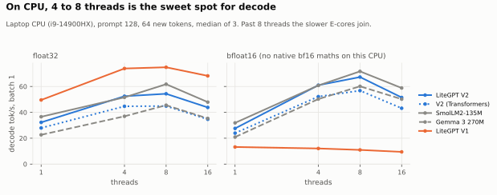

**float32, prompt 128 tokens**

| Model | Parameters | Weights, GB | Peak RAM, GiB | Load, s | Prefill tok/s, 4 threads | Decode tok/s, 1 / 4 / 8 / 16 threads | First token, 4 threads, s |
|---|---:|---:|---:|---:|---:|---:|---:|
| **LiteGPT V2** | 201.4M | 0.81 | 1.66 | 1.6 | 953 | 32.3 / 52.5 / 54.4 / 43.8 | 0.13 |
| LiteGPT V2 (Transformers) | 201.4M | 0.81 | 1.98 | 2.7 | 835 | 27.9 / 44.7 / 44.9 / 34.6 | 0.15 |
| SmolLM2-135M | 134.5M | 0.54 | 1.61 | 3.1 | 1,112 | 36.6 / 51.6 / 61.8 / 47.9 | 0.12 |
| Gemma 3 270M | 268.1M | 1.07 | 2.60 | 3.6 | 1,105 | 22.6 / 37.0 / 45.5 / 35.3 | 0.12 |
| LiteGPT V1 | 124.5M | 0.50 | 1.42 | 2.7 | 1,580 | 49.6 / 73.9 / 74.9 / 68.2 | 0.08 |

With a 512-token prompt on 4 threads, V2 prefills at 988 tok/s, decodes at 50.2 tok/s and gives its first token in 0.52 s.

- **V2 decodes as fast as SmolLM2-135M on 4 threads** (52.5 against 51.6 tok/s) while being 1.5 times its size, and 42% faster than Gemma 3 270M. On 8 threads SmolLM2 pulls ahead.
- **LiteGPT's own engine is 17% faster than Transformers** at decode for the same V2 weights, and uses 0.32 GiB less RAM.
- **Decode is limited by memory bandwidth.** V2 reads its weights at 42 GB/s on 4 threads, against 60 GB/s measured. Past 8 threads the efficiency cores join and every model slows down.
- **Use float32 on this CPU.** Without native bf16 maths, bf16 prefill is 3.5 to 5 times slower for V2 and the rivals. bf16 decode is a little faster because half the bytes are read:

| Model, 4 threads | Decode tok/s, fp32 / bf16 | Prefill tok/s, fp32 / bf16 | Peak RAM GiB, fp32 / bf16 |
|---|---:|---:|---:|
| **LiteGPT V2** | 52.5 / 61.0 | 953 / 197 | 1.66 / 1.68 |
| LiteGPT V2 (Transformers) | 44.7 / 52.2 | 835 / 185 | 1.98 / 1.27 |
| SmolLM2-135M | 51.6 / 60.8 | 1,112 / 233 | 1.61 / 1.15 |
| Gemma 3 270M | 37.0 / 50.3 | 1,105 / 308 | 2.60 / 1.62 |
| LiteGPT V1 | 73.9 / 12.1 | 1,580 / 22 | 1.42 / 1.54 |

V1 runs on Transformers' GPT-2 code, whose bf16 path is very slow on this CPU. Use V1 in float32.

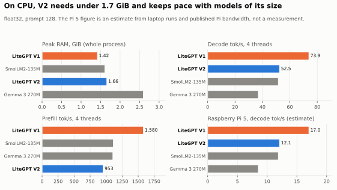

### Raspberry Pi estimates

These are **estimates, not measurements**: no Pi was run. They scale the laptop's 4-thread results to the board.

- **Decode** is multiplied by the ratio of the Pi's memory bandwidth to the laptop's (59.9 GB/s on 4 threads), and capped by the Pi's bandwidth divided by the weight bytes read per token. The bandwidth used is about 13.8 GB/s sustained read for the Pi 5, measured in [Arm's LLM decode roofline guide](https://learn.arm.com/learning-paths/cross-platform/llm-decode-roofline/measure-bandwidth/), and about 2.2 GB/s for the Pi 3 Model B, from [RAMspeed on OpenBenchmarking](https://openbenchmarking.org/result/1604209-GA-RPI3RAMSP14).
- **Prefill** is divided by the per-core peak float32 throughput from specs: a Cortex-A76 at 2.4 GHz has about 4 times less than one of the laptop's performance cores, and a Cortex-A53 at 1.2 GHz about 16 times less. It is shown as a range from half to 1.5 times that, because we found no measured figure.
- **Memory fit** compares the laptop's peak RAM with 3.2 GB usable on a 4 GB Pi 5, 7.2 GB on an 8 GB one, and 0.75 GB on a 1 GB Pi 3.
- **Assumed:** a 64-bit OS and PyTorch's aarch64 build, with 4 threads. Neither board has native bf16 maths, so float32 is the recommended setting.

**Raspberry Pi 5, float32, prompt 128 tokens (estimate)**

| Model | Decode tok/s (ceiling) | Prefill tok/s, range | First token, s | Fits in 4 GB |
|---|---:|---:|---:|---|
| **LiteGPT V2** | 12.1 (17.1) | 238 (119 to 357) | 0.5 | yes, peak 1.66 GiB |
| SmolLM2-135M | 11.9 (25.6) | 278 (139 to 417) | 0.5 | yes, peak 1.61 GiB |
| Gemma 3 270M | 8.5 (12.9) | 276 (138 to 414) | 0.5 | yes, peak 2.60 GiB |
| LiteGPT V1 | 17.0 (27.7) | 395 (198 to 593) | 0.3 | yes, peak 1.42 GiB |

In bf16 the estimate for V2 is 14.0 tok/s decode, but about 2.6 s to the first token, so float32 is the better setting on a Pi 5.

**Raspberry Pi 3 Model B (estimate):** about 1.9 tok/s decode for V2 in float32, and about 2 s to the first token for a 128-token prompt. None of the four models fits in 1 GB with PyTorch: V2's float32 weights alone are 0.81 GB, and its bf16 run peaks at 1.68 GiB. A Pi 3 needs a lighter runtime and 8-bit weights.

All figures come from `runs/*-bench-cpu-*` and `benchmarks/cpu_bench.py`, run as `python -m benchmarks.cpu_bench all`.

## V2 against V1

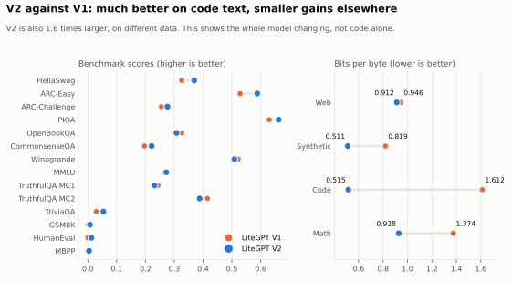

Architecture, tokenizer, data and size all changed between versions, so this shows the whole model improving and can't credit any one part. The design ladder tested the parts one at a time.

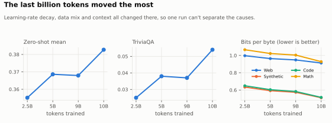

## Where V2 leads, and how far that goes

| Measure | V2 | Next best | Limit |
|---|---:|---:|---|
| GPU memory, batch of 8 | 0.59 GiB, lowest of all 11 | SmolLM2-135M 0.73 | Different engines |
| GPU decode against SmolLM2, Gemma and Qwen | 86 tok/s | Qwen2.5-0.5B 64 | Different engines; older, shallower models are faster |
| CPU decode on 4 threads, float32 | 52.5 tok/s in 1.66 GiB | SmolLM2-135M 51.6 | SmolLM2 is faster on 8 threads; different engines |
| Code bits per byte, under 300M parameters | 0.515 | SmolLM2-135M 0.559 | Does not mean working code |
| First token on CPU, short documents | MASSIVE 0.15 s, Banking77 0.11 s | SmolLM2 0.18 s, Gemma 0.14 s | Small samples; slower than SmolLM2 and Gemma on CUAD |
| Generation speed on BillSum | 103 s | Gemma 125 s | V2's summaries scored lowest |
| Against V1 | Clearly better on 5 tasks, none clearly worse | | V1 is 124.5M parameters, V2 201.4M |

## How it was built

| Item | Value |
|---|---|
| Pretraining | 37.2 h on one rented A100, 0 restarts, 0 skipped steps |
| Chat fine-tuning and comparison | About 18 h on one rented A100 |
| Before that | Design, data and experiments on one RTX 4090 Laptop GPU |
| Benchmark overlap | Documents sharing a 13-word run with 18 evaluation sets removed before training. For the comparison, test items matched by training text removed for every model, and a zero-match score reported |
| Licensing filters | Wikipedia excluded (share-alike). Code kept only from permissive-labelled repositories, with copyleft-headed files, keys and credentials removed and email addresses redacted. The label is repository-level, not a per-file audit |
| Reproducibility | Every config, dataset revision and threshold is recorded. **No one has rebuilt the model independently** |
