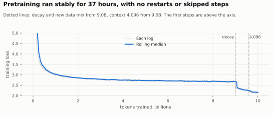
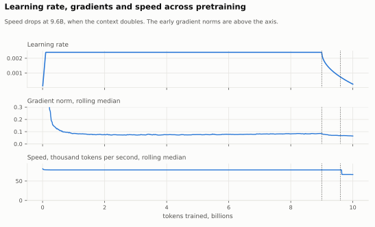
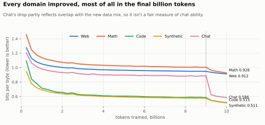
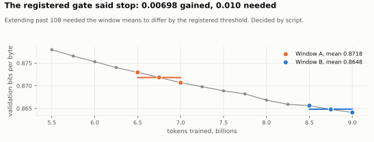
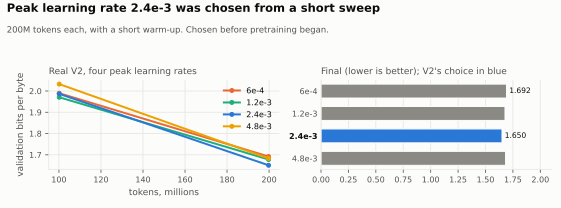
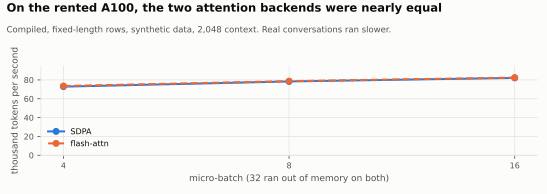
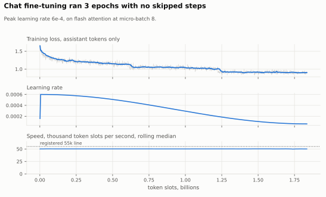
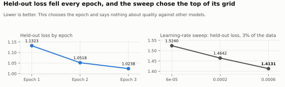
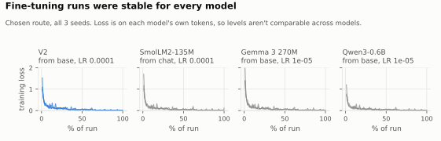

# Training

Configs: [`benchmarks/m3/`](../benchmarks/m3), [`benchmarks/m4/`](../benchmarks/m4). Thresholds and results: [`docs/spec/registry.yaml`](spec/registry.yaml). Scores: [`results.md`](results.md).

## Pretraining (M3, EXP-G1-EXTENSION-GATE)

| Item | Value |
|---|---|
| Run | `20261101T142254Z-train-m3-673cd85`, one A100 PCIe 40 GB capped at 250 W |
| Length | 19,075 steps, 10.0B tokens, 37.2 h, 0 restarts, 0 skipped steps |
| Schedule | Warm-up and stable, then decay, with the last phase at 4,096 context |
| Gate | The registered gate at 9.0B decided to stop rather than extend (improvement 0.00698, below the 0.010 line) |
| Result | Validation 0.8197 bits per byte |
| Cost | $16.64 |

## Chat fine-tuning (M4, EXP-M4-SFT)

`litegpt/training/sft.py`, `scripts/train_sft.py`. Assistant-only loss from the chat template, whole conversations packed with `cu_seqlens`.

| Item | Value |
|---|---|
| Data | 385,677 conversations, 497M tokens (reserved SmolTalk subsets and smol-magpie-ultra). Held out: 3,846 |
| Learning rate | 6e-4 from {6e-5, 2e-4, 6e-4} on 3% of the data. It is the top of the grid |
| Length | 3 epochs, 14,000 steps. No skipped steps |
| Held-out loss | 1.1323, 1.0518, 1.0238 |
| Gate G2 | Passed: IFEval 0.1312 against V1-Instruct 0.0832, 2.56 standard errors |

The held-out loss chooses the epoch and says nothing about quality against other models.

**Deviation:** real packed steps ran at 46.7k tokens per second, below the registered 55k stop. The owner chose to continue, on flash attention at micro-batch 8 (50.1k mean).

Reasoning and preference tuning were deferred ([ADR-010](decisions/ADR-010-m4-scope-text-to-data-comparison-and-cloud.md)).

## Fine-tuning for text-to-data (M4, EXP-M4-T2D)

`litegpt/t2d_run.py`, `scripts/run_t2d.py`, recipe in `benchmarks/m4/t2d.yaml`. Every model gets the same recipe: whole model, AdamW, loss on output tokens only, 3 epochs, 3 seeds, learning rate chosen from {1e-5, 3e-5, 1e-4} on dev. Each model's route is chosen on dev, and the test set is scored once.

## Running it unattended

`scripts/cloud/m4_queue.py` runs a job list that survives restarts. `scripts/cloud/m3_guard.py` watches spend, stops the server at a set limit, and proves backups by hash.

**Known gap:** `scripts/cloud/m4_backup.py` uploads `runs/*-train-m4-*` and the queue's folders. It does not upload evaluation runs, so the G2 record had to be recovered from the server's volume.
