# LiteGPT V2: generated report

> Generated by `python -m scripts.build_report` from the run records in `runs/`. Do not edit by hand.

## 1. Specification

| item | value |
|---|---|
| spec version | `2.0.0-spec.6` |
| spec sha256 | `3a7786f09e0e21d3…` |
| code licence / model licence | MIT / pending-dataset-audit |
| python / torch (pinned) | 3.12 / 2.14.1+cu130 |
| attention | sdpa mandatory; flash-attn 2.8.3+cu130torch2.14 optional (adopted-for-auto) |
| pretraining budget | 10B tokens (max 15B), ~7 days, requires 16,500 tok/s sustained |
| extension gate (pre-registered) | Δ val_bpb over [6.5–7.0]B vs [8.5–9.0]B ≥ 0.01 → extend to 15B, else stop at 10B |

## 2. Architecture and parameters

| model | layers | d_model | attention | FFN | positions | norm | vocab | context |
|---|---|---|---|---|---|---|---|---|
| V1 (GPT-2 Small) | 12 | 768 | 12 MHA | GELU 4d (3072) | learned | LayerNorm | 50,304 | 1,024 |
| V2 24L (fallback) | 24 | 768 | 12Q/4KV GQA | SwiGLU (2048) | RoPE | RMSNorm + QK-norm | 32,768 | 2,048 |
| V2 28L (approved) | 28 | 768 | 12Q/4KV GQA | SwiGLU (2048) | RoPE | RMSNorm + QK-norm | 32,768 | 2,048 |

| model | total params | embedding params | non-embedding params | FLOPs/token (full-attn, MFU convention) | FLOPs/token (causal) |
|---|---|---|---|---|---|
| V1 (GPT-2 Small) | 124.37M | 39.42M | 84.95M | 0.855 G | 0.798 G |
| V2 24L (fallback) | 176.20M | 25.17M | 151.04M | 1.510 G | 1.284 G |
| V2 28L (approved) | 201.37M | 25.17M | 176.21M | 1.737 G | 1.472 G |

V1 is shown as trained (bias-free, vocab 50,304, context 1,024); its embedding count includes the learned position table.

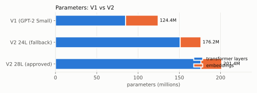

V2 28L parameter breakdown:

| component | params | share |
|---|---|---|
| token embedding (tied with output) | 25.17M | 12.5% |
| attention projections (q,k,v,o) | 44.04M | 21.9% |
| FFN (SwiGLU) | 132.12M | 65.6% |
| norms (RMSNorm + QK-norm) | 0.05M | 0.0% |

## 3. Training throughput and memory (M0 benchmarks)

### Windows native: run `20261006T122603Z-bench-train_mem-m0-101c3f8`

GPU NVIDIA GeForce RTX 4090 Laptop GPU (15.99 GiB), driver 610.88, torch 2.14.1+cu130 (CUDA 13.0), Python 3.12.15, uv.lock `d3e8230123cf`, git `101c3f8` (dirty). Measured bf16 matmul ceiling: 76.78 TFLOPS.

| config | micro-batch×seq | attention | compile | status | tok/s | TFLOPS (full) | MFU vs ceiling | peak VRAM GiB | ≥16.5k tok/s |
|---|---|---|---|---|---|---|---|---|---|
| v2-28l | 4×2048 | flash | no | skipped | – | – | – | – | n/a |
| v2-28l | 2×2048 | sdpa | no | ok | 20,247 | 35.2 | 46% | 8.34 | yes |
| v2-28l | 4×2048 | sdpa | no | oom | – | – | – | 12.97 | no |
| v2-28l | 6×2048 | sdpa | no | oom | – | – | – | 13.60 | no |
| v2-28l | 8×2048 | sdpa | no | oom | – | – | – | 13.70 | no |
| v2-28l | 2×4096 | sdpa | no | oom | – | – | – | 12.97 | n/a |
| v2-24l | 4×2048 | sdpa | no | ok ⚠ VRAM pressure (spill risk, not a valid throughput) | 24,493 | 37.0 | 48% | 12.43 | no |
| v2-28l | 4×2048 | sdpa | yes | compile_error | – | – | – | 0.75 | no |
| v2-28l | 2×2048 | sdpa | yes | compile_error | – | – | – | 0.75 | no |

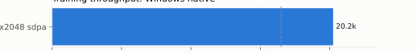

- `litegpt-v2-28l` mb4×2048 flash: `flash-attn is not installed`
- `litegpt-v2-28l` mb4×2048 sdpa compile: `TritonMissing: Cannot find a working triton installation. Either the package is not installed or it is too old. More information on installing Triton can be found at: https://github.com/triton-lang/tr`
- `litegpt-v2-28l` mb2×2048 sdpa compile: `TritonMissing: Cannot find a working triton installation. Either the package is not installed or it is too old. More information on installing Triton can be found at: https://github.com/triton-lang/tr`

### Windows native: run `20261006T122954Z-bench-train_mem-m0-101c3f8`

GPU NVIDIA GeForce RTX 4090 Laptop GPU (15.99 GiB), driver 610.88, torch 2.14.1+cu130 (CUDA 13.0), Python 3.12.15, uv.lock `d3e8230123cf`, git `101c3f8` (dirty). Measured bf16 matmul ceiling: 78.78 TFLOPS.

| config | micro-batch×seq | attention | compile | status | tok/s | TFLOPS (full) | MFU vs ceiling | peak VRAM GiB | ≥16.5k tok/s |
|---|---|---|---|---|---|---|---|---|---|
| v2-28l | 2×2048 | flash | no | skipped | – | – | – | – | n/a |
| v2-28l | 1×2048 | sdpa | no | ok | 13,163 | 22.9 | 29% | 5.51 | no |
| v2-28l | 2×2048 | sdpa | no | ok | 20,700 | 36.0 | 46% | 8.34 | yes |
| v2-28l | 3×2048 | sdpa | no | ok | 22,279 | 38.7 | 49% | 11.17 | yes |
| v2-28l | 4×2048 | sdpa | no | oom | – | – | – | 12.97 | no |
| v2-28l | 1×4096 | sdpa | no | ok | 17,674 | 40.0 | 51% | 8.34 | n/a |
| v2-24l | 2×2048 | sdpa | no | ok | 23,840 | 36.0 | 46% | 7.41 | yes |
| v2-24l | 3×2048 | sdpa | no | ok | 25,576 | 38.6 | 49% | 9.92 | yes |
| v2-28l | 2×2048 | sdpa | yes | compile_error | – | – | – | 0.75 | no |

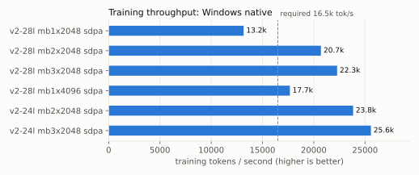

- `litegpt-v2-28l` mb2×2048 flash: `flash-attn is not installed`
- `litegpt-v2-28l` mb2×2048 sdpa compile: `TritonMissing: Cannot find a working triton installation. Either the package is not installed or it is too old. More information on installing Triton can be found at: https://github.com/triton-lang/tr`

### Windows native: run `20261006T130256Z-bench-sustained-28l-mb3-30min-101c3f8`

GPU NVIDIA GeForce RTX 4090 Laptop GPU (15.99 GiB), driver 610.88, torch 2.14.1+cu130 (CUDA 13.0), Python 3.12.15, uv.lock `d3e8230123cf`, git `101c3f8` (dirty). Measured bf16 matmul ceiling: 46.77 TFLOPS.

| config | micro-batch×seq | attention | compile | status | tok/s | TFLOPS (full) | MFU vs ceiling | peak VRAM GiB | ≥16.5k tok/s |
|---|---|---|---|---|---|---|---|---|---|
| v2-28l | 3×2048 | sdpa | no | ok | 15,553 | 27.0 | 58% | 11.17 | no |

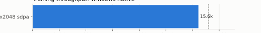

- Sustained 1800 s: first-minute 20,550 → last-minute 14,812 tok/s (ratio 0.721); power-capped 2% / thermally throttled 98% of busy samples; mean GPU power 102 W (power limit not recorded by this run).

### Windows native: run `20261006T131103Z-bench-ab-sdpa-vs-flash-101c3f8`

GPU NVIDIA GeForce RTX 4090 Laptop GPU (15.99 GiB), driver 610.88, torch 2.14.1+cu130 (CUDA 13.0), Python 3.12.15, uv.lock `9556b5432180`, git `101c3f8` (dirty). Measured bf16 matmul ceiling: 52.49 TFLOPS.

| config | micro-batch×seq | attention | compile | status | tok/s | TFLOPS (full) | MFU vs ceiling | peak VRAM GiB | ≥16.5k tok/s |
|---|---|---|---|---|---|---|---|---|---|
| v2-28l | 3×2048 | sdpa | no | ok | 15,392 | 26.7 | 51% | 11.17 | n/a |
| v2-28l | 3×2048 | flash | no | ok | 17,411 | 30.2 | 58% | 11.17 | n/a |
| v2-28l | 3×2048 | sdpa | no | ok | 15,671 | 27.2 | 52% | 11.17 | n/a |
| v2-28l | 3×2048 | flash | no | ok | 17,395 | 30.2 | 58% | 11.17 | n/a |
| v2-28l | 3×2048 | sdpa | no | ok | 15,201 | 26.4 | 50% | 11.17 | n/a |
| v2-28l | 3×2048 | flash | no | ok | 17,311 | 30.1 | 57% | 11.17 | n/a |
| v2-28l | 3×2048 | sdpa | no | ok | 15,236 | 26.5 | 50% | 11.17 | n/a |
| v2-28l | 3×2048 | flash | no | ok | 16,884 | 29.3 | 56% | 11.17 | n/a |

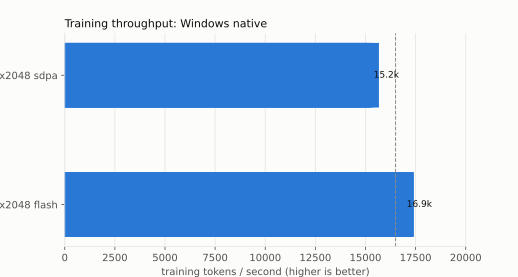

| side | runs | tok/s mean (min-max) | peak VRAM GiB | warmup s | final loss |
|---|---|---|---|---|---|
| sdpa | 4 | 15,375 (15,201-15,671) | 11.17 | – | – |
| flash | 4 | 17,250 (16,884-17,411) | 11.17 | – | – |

**Speedup B over A: 1.122x**


### Windows native: run `20261006T134753Z-bench-sustained-28l-mb3-flash-30min-101c3f8`

GPU NVIDIA GeForce RTX 4090 Laptop GPU (15.99 GiB), driver 610.88, torch 2.14.1+cu130 (CUDA 13.0), Python 3.12.15, uv.lock `9556b5432180`, git `101c3f8` (dirty). Measured bf16 matmul ceiling: 56.2 TFLOPS.

| config | micro-batch×seq | attention | compile | status | tok/s | TFLOPS (full) | MFU vs ceiling | peak VRAM GiB | ≥16.5k tok/s |
|---|---|---|---|---|---|---|---|---|---|
| v2-28l | 3×2048 | flash | no | ok | 17,553 | 30.5 | 54% | 11.17 | yes |

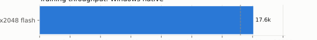

- Sustained 1800 s: first-minute 17,001 → last-minute 17,131 tok/s (ratio 1.008); power-capped 100% / thermally throttled 7% of busy samples; mean GPU power 95 W (power limit not recorded by this run).

### WSL2 (Ubuntu / 6.18.40.1-microsoft-standard-WSL2): run `20261006T143350Z-bench-ab-sdpa-vs-sdpa-compile-101c3f8`

GPU NVIDIA GeForce RTX 4090 Laptop GPU (15.99 GiB), driver 610.88, torch 2.14.1+cu130 (CUDA 13.0), Python 3.12.15, uv.lock `9556b5432180`, git `101c3f8` (dirty). Measured bf16 matmul ceiling: 53.78 TFLOPS.

| config | micro-batch×seq | attention | compile | status | tok/s | TFLOPS (full) | MFU vs ceiling | peak VRAM GiB | ≥16.5k tok/s |
|---|---|---|---|---|---|---|---|---|---|
| v2-28l | 3×2048 | sdpa | no | ok | 18,754 | 32.6 | 61% | 11.17 | n/a |
| v2-28l | 3×2048 | sdpa | yes | ok | 23,247 | 40.4 | 75% | 8.28 | n/a |
| v2-28l | 3×2048 | sdpa | no | ok | 18,545 | 32.2 | 60% | 11.17 | n/a |
| v2-28l | 3×2048 | sdpa | yes | ok | 22,822 | 39.6 | 74% | 8.28 | n/a |
| v2-28l | 3×2048 | sdpa | no | ok | 18,476 | 32.1 | 60% | 11.17 | n/a |
| v2-28l | 3×2048 | sdpa | yes | ok | 23,045 | 40.0 | 74% | 8.28 | n/a |
| v2-28l | 3×2048 | sdpa | no | ok | 18,467 | 32.1 | 60% | 11.17 | n/a |
| v2-28l | 3×2048 | sdpa | yes | ok | 22,871 | 39.7 | 74% | 8.28 | n/a |

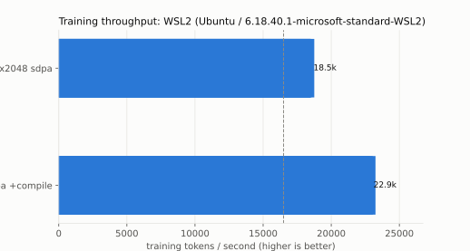

| side | runs | tok/s mean (min-max) | peak VRAM GiB | warmup s | final loss |
|---|---|---|---|---|---|
| A:sdpa | 4 | 18,561 (18,467-18,754) | 11.17 | 4.1 | 7.05024 |
| B:sdpa+compile | 4 | 22,997 (22,822-23,247) | 8.28 | 13.1 | 6.86714 |

**Speedup B over A: 1.239x** (final-loss relative difference 2.6%, training drift on a repeated synthetic batch)


### WSL2 (Ubuntu / 6.18.40.1-microsoft-standard-WSL2): run `20261006T143939Z-bench-compile-28l-mb4-2048-101c3f8`

GPU NVIDIA GeForce RTX 4090 Laptop GPU (15.99 GiB), driver 610.88, torch 2.14.1+cu130 (CUDA 13.0), Python 3.12.15, uv.lock `9556b5432180`, git `101c3f8` (dirty). Measured bf16 matmul ceiling: 53.82 TFLOPS.

| config | micro-batch×seq | attention | compile | status | tok/s | TFLOPS (full) | MFU vs ceiling | peak VRAM GiB | ≥16.5k tok/s |
|---|---|---|---|---|---|---|---|---|---|
| v2-28l | 4×2048 | sdpa | yes | ok | 23,695 | 41.1 | 76% | 10.14 | yes |


### WSL2 (Ubuntu / 6.18.40.1-microsoft-standard-WSL2): run `20261006T144041Z-bench-compile-28l-mb5-2048-101c3f8`

GPU NVIDIA GeForce RTX 4090 Laptop GPU (15.99 GiB), driver 610.88, torch 2.14.1+cu130 (CUDA 13.0), Python 3.12.15, uv.lock `9556b5432180`, git `101c3f8` (dirty). Measured bf16 matmul ceiling: 53.88 TFLOPS.

| config | micro-batch×seq | attention | compile | status | tok/s | TFLOPS (full) | MFU vs ceiling | peak VRAM GiB | ≥16.5k tok/s |
|---|---|---|---|---|---|---|---|---|---|
| v2-28l | 5×2048 | sdpa | yes | ok | 23,441 | 40.7 | 76% | 12.04 | yes |


### WSL2 (Ubuntu / 6.18.40.1-microsoft-standard-WSL2): run `20261006T144123Z-bench-compile-28l-mb6-2048-101c3f8`

GPU NVIDIA GeForce RTX 4090 Laptop GPU (15.99 GiB), driver 610.88, torch 2.14.1+cu130 (CUDA 13.0), Python 3.12.15, uv.lock `9556b5432180`, git `101c3f8` (dirty). Measured bf16 matmul ceiling: 49.11 TFLOPS.

| config | micro-batch×seq | attention | compile | status | tok/s | TFLOPS (full) | MFU vs ceiling | peak VRAM GiB | ≥16.5k tok/s |
|---|---|---|---|---|---|---|---|---|---|
| v2-28l | 6×2048 | sdpa | yes | oom | – | – | – | 13.11 | no |


### WSL2 (Ubuntu / 6.18.40.1-microsoft-standard-WSL2): run `20261006T144221Z-bench-compile-28l-mb2-4096-101c3f8`

GPU NVIDIA GeForce RTX 4090 Laptop GPU (15.99 GiB), driver 610.88, torch 2.14.1+cu130 (CUDA 13.0), Python 3.12.15, uv.lock `9556b5432180`, git `101c3f8` (dirty). Measured bf16 matmul ceiling: 53.81 TFLOPS.

| config | micro-batch×seq | attention | compile | status | tok/s | TFLOPS (full) | MFU vs ceiling | peak VRAM GiB | ≥16.5k tok/s |
|---|---|---|---|---|---|---|---|---|---|
| v2-28l | 2×4096 | sdpa | yes | ok | 20,792 | 47.1 | 88% | 10.14 | n/a |


### WSL2 (Ubuntu / 6.18.40.1-microsoft-standard-WSL2): run `20261006T151250Z-bench-sustained-28l-mb4-compile-wsl-30min-101c3f8`

GPU NVIDIA GeForce RTX 4090 Laptop GPU (15.99 GiB), driver 610.88, torch 2.14.1+cu130 (CUDA 13.0), Python 3.12.15, uv.lock `9556b5432180`, git `101c3f8` (dirty). Measured bf16 matmul ceiling: 51.73 TFLOPS.

| config | micro-batch×seq | attention | compile | status | tok/s | TFLOPS (full) | MFU vs ceiling | peak VRAM GiB | ≥16.5k tok/s |
|---|---|---|---|---|---|---|---|---|---|
| v2-28l | 4×2048 | sdpa | yes | ok | 22,592 | 39.2 | 76% | 10.14 | yes |


- Sustained 1800 s: first-minute 22,850 → last-minute 22,326 tok/s (ratio 0.977); power-capped 100% / thermally throttled 16% of busy samples; mean GPU power 95 W (power limit not recorded by this run).

### WSL2 (Ubuntu / 6.18.40.1-microsoft-standard-WSL2): run `20261006T162546Z-bench-sustained-28l-mb4-flash-compile-wsl-30min-101c3f8`

GPU NVIDIA GeForce RTX 4090 Laptop GPU (15.99 GiB), driver 610.88, torch 2.14.1+cu130 (CUDA 13.0), Python 3.12.15, uv.lock `a7bb42954016`, git `101c3f8` (dirty). Measured bf16 matmul ceiling: 72.45 TFLOPS.

| config | micro-batch×seq | attention | compile | status | tok/s | TFLOPS (full) | MFU vs ceiling | peak VRAM GiB | ≥16.5k tok/s |
|---|---|---|---|---|---|---|---|---|---|
| v2-28l | 4×2048 | flash | yes | ok | 29,944 | 52.0 | 72% | 10.14 | yes |


- Sustained 1800 s: first-minute 23,697 → last-minute 30,190 tok/s (ratio 1.274); power-capped 100% / thermally throttled 0% of busy samples; mean GPU power 151 W (power limit not recorded by this run).

### Compiled vs eager equivalence (identical weights, bf16 autocast)

| environment | config | loss abs diff | logits rel L2 diff | grad-norm rel diff | result |
|---|---|---|---|---|---|
| WSL2 (Ubuntu / 6.18.40.1-microsoft-standard-WSL2) | v2-28l 3x2048 | 0.0004 | 0.88% | 0.003% | pass |
| WSL2 (Ubuntu / 6.18.40.1-microsoft-standard-WSL2) | v2-28l 3x2048 | 0.0002 | 0.88% | 0.001% | pass |

## 3b. GPU operating-point sweep (EXP-M0-POWER)

### screen: WSL2 (Ubuntu / 6.18.40.1-microsoft-standard-WSL2), run `20261006T164224Z-bench-power-sweep-screen-101c3f8`

Workload: {'config': 'litegpt-v2-28l', 'micro_batch': 4, 'seq_len': 2048, 'backend': 'sdpa', 'compile': True, 'dtype': 'bfloat16'}. Elevated: False; AC power: True; Lenovo mode: unavailable: Access denied; voltage readout: unavailable (not exposed by NVML / nvidia-smi on this GPU). Notes: validation screen; non-elevated session; current Lenovo mode; owner-stated max cooling + AC

| point | status | valid | candidate | tok/s | tok/s/W | GPU W mean/peak | power limit W | SM MHz mean | temp C mean/max | util % | VRAM MiB | thermal thr. | power cap | measured s | reasons |
|---|---|---|---|---|---|---|---|---|---|---|---|---|---|---|---|
| observe | ok | yes | no | 31,120 | 201.4 | 155 / 170 | 152-155 | 2,060 | 76 / 80 | 99 | 12,996 | 0% | 100% | 211 | throughput decayed (last/first 0.9609) |
| lgc:1950 | skipped | no | no | - | - | - / - | --- | - | - / - | - | - | - | - | - | status=skipped; non-finite or missing loss; no measurement |

Recommended (pre-registered rule): **none**; Pareto front: observe

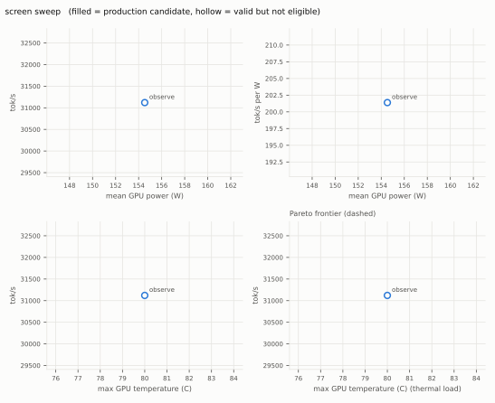

### auto: WSL2 (Ubuntu / 6.18.40.1-microsoft-standard-WSL2), run `20261006T170001Z-bench-power-sweep-auto-101c3f8`

Workload: {'config': 'litegpt-v2-28l', 'micro_batch': 4, 'seq_len': 2048, 'backend': 'sdpa', 'compile': True, 'dtype': 'bfloat16'}. Elevated: False; AC power: True; Lenovo mode: unavailable: Access denied; voltage readout: unavailable (not exposed by NVML / nvidia-smi on this GPU). Notes: pipeline smoke test (short durations)

Protocol: {'preheat_minutes': 1.0, 'segment_minutes': 2.0, 'settle_seconds': 30.0, 'cap_steps_mhz': [100, 200, 300], 'soak_minutes': 2.0, 'window_seconds': 30.0, 'caps_enabled': False}; natural clock - MHz; not elevated: start WSL from an Administrator terminal to enable clock caps

| point | status | valid | candidate | tok/s | tok/s/W | GPU W mean/peak | power limit W | SM MHz mean | temp C mean/max | util % | VRAM MiB | thermal thr. | power cap | measured s | reasons |
|---|---|---|---|---|---|---|---|---|---|---|---|---|---|---|---|
| preheat | ok | yes | yes | 30,752 | 198.8 | 155 / 158 | 151-155 | 2,096 | 76 / 78 | 99 | 12,960 | 0% | 100% | 60 | - |
| observe | ok | yes | yes | 30,453 | 197.1 | 154 / 157 | 153-155 | 2,054 | 79 / 81 | 99 | 12,981 | 0% | 100% | 60 | - |
| soak@observe | ok | yes | no | 30,362 | 196.9 | 154 / 163 | 154-155 | 2,047 | 81 / 83 | 99 | 12,957 | 0% | 100% | 61 | max temperature 83 C > 82.0 C (target - margin) |

Recommended (pre-registered rule): **observe**; Pareto front: observe; **soak passed: False**


### auto: WSL2 (Ubuntu / 6.18.40.1-microsoft-standard-WSL2), run `20261006T171445Z-bench-power-sweep-auto-101c3f8`

Workload: {'config': 'litegpt-v2-28l', 'micro_batch': 4, 'seq_len': 2048, 'backend': 'sdpa', 'compile': True, 'dtype': 'bfloat16'}. Elevated: True; AC power: True; Lenovo mode: 255; voltage readout: unavailable (not exposed by NVML / nvidia-smi on this GPU). Notes: owner-stated max cooling + AC

Protocol: {'preheat_minutes': 4.0, 'segment_minutes': 4.0, 'settle_seconds': 60.0, 'cap_steps_mhz': [100, 200, 300], 'soak_minutes': 60.0, 'window_seconds': 30.0, 'caps_enabled': True}; natural clock 2012.7 MHz

| point | status | valid | candidate | tok/s | tok/s/W | GPU W mean/peak | power limit W | SM MHz mean | temp C mean/max | util % | VRAM MiB | thermal thr. | power cap | measured s | reasons |
|---|---|---|---|---|---|---|---|---|---|---|---|---|---|---|---|
| preheat | ok | no | no | 31,662 | 204.9 | 155 / 163 | 151-155 | 2,076 | 72 / 79 | 99 | 13,006 | 0% | 100% | 210 | loss spike 286.6% |
| observe | ok | yes | no | 31,200 | 201.8 | 155 / 157 | 151-155 | 2,013 | 81 / 83 | 99 | 13,005 | 0% | 100% | 151 | max temperature 83 C > 82.0 C (target - margin) |
| lgc:1905 | ok | no | no | 29,764 | 210.9 | 141 / 151 | 146-155 | 1,905 | 80 / 81 | 99 | 12,798 | 0% | 1% | 153 | loss spike 79.8% |
| lgc:1800 | ok | no | no | 28,612 | 217.2 | 132 / 149 | 146-153 | 1,800 | 79 / 79 | 99 | 12,788 | 0% | 0% | 153 | loss spike 144.9% |
| lgc:1710 | ok | no | no | 27,442 | 226.0 | 121 / 133 | 142-151 | 1,710 | 76 / 77 | 99 | 12,787 | 0% | 0% | 154 | loss spike 66.5% |

Recommended (pre-registered rule): **none**; Pareto front: observe; **soak passed: None**

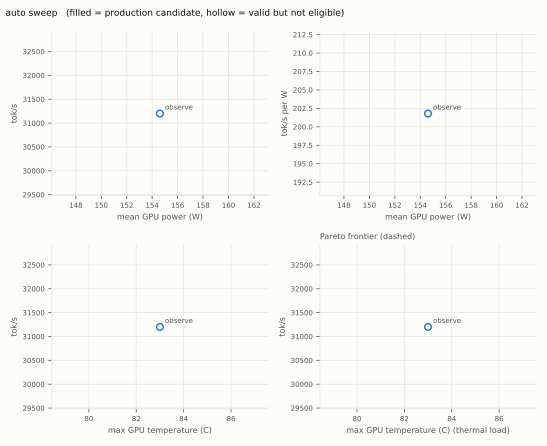

### auto: WSL2 (Ubuntu / 6.18.40.1-microsoft-standard-WSL2), run `20261006T173836Z-bench-power-sweep-auto-101c3f8`

Workload: {'config': 'litegpt-v2-28l', 'micro_batch': 4, 'seq_len': 2048, 'backend': 'sdpa', 'compile': True, 'dtype': 'bfloat16', 'data': 'fresh random tokens every step (unlearnable: loss stays near ln(vocab) ~ 10.4)'}. Elevated: False; AC power: True; Lenovo mode: unavailable: Access denied; voltage readout: unavailable (not exposed by NVML / nvidia-smi on this GPU). Notes: pipeline smoke test (short durations)

Protocol: {'preheat_minutes': 1.0, 'segment_minutes': 2.0, 'settle_seconds': 30.0, 'cap_steps_mhz': [100, 200, 300], 'soak_minutes': 2.0, 'window_seconds': 30.0, 'caps_enabled': False}; natural clock - MHz; not elevated: start WSL from an Administrator terminal to enable clock caps

| point | status | valid | candidate | tok/s | tok/s/W | GPU W mean/peak | power limit W | SM MHz mean | temp C mean/max | util % | VRAM MiB | thermal thr. | power cap | measured s | reasons |
|---|---|---|---|---|---|---|---|---|---|---|---|---|---|---|---|
| preheat | ok | yes | yes | 31,316 | 202.8 | 154 / 163 | 152-155 | 2,129 | 68 / 72 | 99 | 12,810 | 0% | 100% | 60 | - |
| observe | ok | yes | yes | 30,896 | 199.6 | 155 / 166 | 154-155 | 2,094 | 77 / 78 | 99 | 12,809 | 0% | 100% | 60 | - |
| soak@observe | ok | yes | yes | 30,660 | 198.4 | 154 / 156 | 151-155 | 2,076 | 80 / 81 | 99 | 12,819 | 0% | 100% | 61 | - |

Recommended (pre-registered rule): **observe**; Pareto front: observe; **soak passed: True**

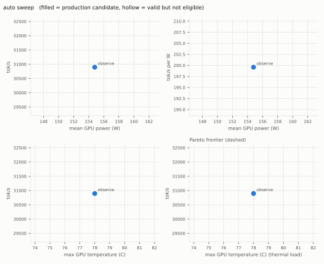

### auto: WSL2 (Ubuntu / 6.18.40.1-microsoft-standard-WSL2), run `20261006T174824Z-bench-power-sweep-auto-101c3f8`

Workload: {'config': 'litegpt-v2-28l', 'micro_batch': 4, 'seq_len': 2048, 'backend': 'sdpa', 'compile': True, 'dtype': 'bfloat16', 'data': 'fresh random tokens every step (unlearnable: loss stays near ln(vocab) ~ 10.4)'}. Elevated: True; AC power: True; Lenovo mode: 255; voltage readout: unavailable (not exposed by NVML / nvidia-smi on this GPU). Notes: owner-stated max cooling + AC; corrected workload (fresh batches)

Protocol: {'preheat_minutes': 4.0, 'segment_minutes': 4.0, 'settle_seconds': 60.0, 'cap_steps_mhz': [50, 100, 200], 'soak_minutes': 60.0, 'window_seconds': 30.0, 'caps_enabled': True}; natural clock 2037.6 MHz

| point | status | valid | candidate | tok/s | tok/s/W | GPU W mean/peak | power limit W | SM MHz mean | temp C mean/max | util % | VRAM MiB | thermal thr. | power cap | measured s | reasons |
|---|---|---|---|---|---|---|---|---|---|---|---|---|---|---|---|
| preheat | ok | yes | yes | 31,853 | 206.3 | 154 / 158 | 145-155 | 2,081 | 73 / 79 | 99 | 12,840 | 0% | 100% | 211 | - |
| observe | ok | yes | no | 31,388 | 202.9 | 155 / 161 | 153-155 | 2,038 | 82 / 83 | 99 | 12,869 | 0% | 100% | 152 | max temperature 83 C > 82.0 C (target - margin) |
| lgc:1980 | ok | yes | no | 30,774 | 206.2 | 149 / 151 | 155-155 | 1,980 | 82 / 83 | 99 | 12,856 | 0% | 0% | 152 | max temperature 83 C > 82.0 C (target - margin) |
| lgc:1935 | ok | yes | yes | 30,204 | 211.9 | 143 / 158 | 150-155 | 1,935 | 81 / 82 | 99 | 12,861 | 0% | 0% | 153 | - |
| lgc:1830 | ok | yes | yes | 28,923 | 217.3 | 133 / 139 | 144-155 | 1,830 | 80 / 80 | 99 | 12,865 | 0% | 0% | 154 | - |
| soak@lgc:1935 | ok | yes | no | 29,650 | 209.1 | 142 / 153 | 146-155 | 1,934 | 81 / 82 | 99 | 13,631 | 0% | 0% | 3528 | throughput decayed (last/first 0.968) |

Recommended (pre-registered rule): **lgc:1935**; Pareto front: observe, lgc:1935, lgc:1830; **soak passed: False**

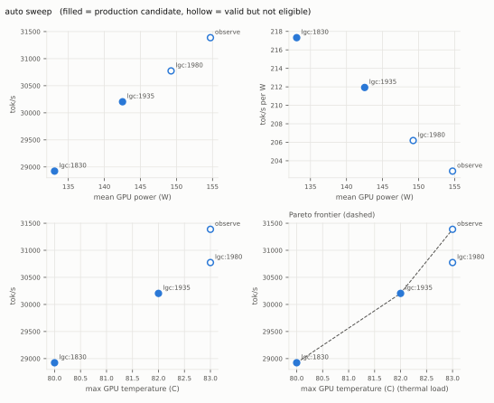

## 3c. Data and tokenizer (M1)

Data run `20261011T173054Z-data-prepare-1f005bc`; sources file sha256 `a4c122bf0979bfab…`.

### Tokens prepared vs plan (millions of tokens)

| source | stable need | stable have | decay need | decay have | val have | min margin |
|---|---|---|---|---|---|---|
| code_javascript | 245 | 327 | 24 | 203 | 17.7 | 1.33x |
| code_python | 1,102 | 1,335 | 109 | 160 | 5.1 | 1.21x |
| code_shell | 88 | 109 | 9 | 11 | 0.9 | 1.24x |
| code_sql | 70 | 74 | 7 | 11 | 0.3 | 1.05x |
| code_typescript | 245 | 344 | 24 | 37 | 2.2 | 1.40x |
| cosmopedia_v2 | 1,458 | 1,948 | 130 | 218 | 6.5 | 1.34x |
| fineweb_edu | 9,042 | 13,004 | 432 | 501 | 27.4 | 1.16x |
| instruction_style | 0 | 0 | 50 | 61 | 3.7 | 1.21x |
| math | 1,750 | 2,090 | 216 | 284 | 6.7 | 1.19x |

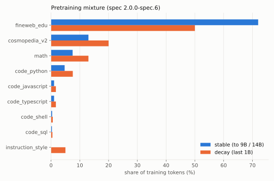

### Tokenizer (frozen) compression, bytes per token (higher is better)

| domain | LiteGPT 32k | GPT-2 50k | SmolLM2 49k | vs GPT-2 |
|---|---|---|---|---|
| web | 4.457 | 4.616 | 4.527 | 0.97x |
| synthetic | 5.227 | 5.149 | 5.239 | 1.02x |
| math | 3.491 | 3.579 | 3.329 | 0.98x |
| code_javascript | 2.643 | 1.897 | 2.474 | 1.39x |
| code_python | 3.786 | 2.188 | 3.517 | 1.73x |
| code_typescript | 3.891 | 2.429 | 3.620 | 1.60x |
| code_shell | 2.819 | 2.361 | 2.627 | 1.19x |
| code_sql | 3.001 | 2.561 | 2.596 | 1.17x |

Tokenizer sha256 `2f208b58085074d9…`; trained on 5.00 GB (1,053,405 documents).

### Code filters (documents dropped per rule)

| language | autogen | copyleft | exportdump | keep_fraction | longline | mirror | path | pyparse | secret | size | sqldump |
|---|---|---|---|---|---|---|---|---|---|---|---|
| code_javascript | 18,504 | 14,052 | 0 | 1,687,118 | 32 | 61,575 | 234,409 | 0 | 2,062 | 32,372 | 0 |
| code_python | 28,551 | 8,862 | 0 | 209,948 | 2 | 0 | 15,612 | 162,157 | 511 | 8,282 | 0 |
| code_shell | 911 | 1,611 | 0 | 41,979 | 0 | 0 | 7,405 | 0 | 79 | 234 | 0 |
| code_sql | 652 | 265 | 3,505 | 0 | 5 | 0 | 765 | 0 | 4 | 941 | 5,942 |
| code_typescript | 2,068 | 151 | 0 | 88,035 | 0 | 335 | 70,620 | 0 | 362 | 31,140 | 0 |

E-mail addresses redacted in 181,283 documents. `keep_fraction` drops only bound disk use.

### Decontamination (documents dropped, 13-gram overlap with the 18 pinned benchmarks)

| source | bytes dropped | ifeval | mmlu | triviaqa | humaneval | mbpp | hellaswag | truthfulqa | arc_easy |
|---|---|---|---|---|---|---|---|---|---|
| code_javascript | 0.13% | 0 | 4 | 6 | 129 | 52 | 0 | 1 | 0 |
| code_python | 0.05% | 0 | 6 | 4 | 128 | 144 | 0 | 0 | 0 |
| code_shell | 0.01% | 0 | 0 | 1 | 1 | 0 | 0 | 0 | 0 |
| code_sql | 0.01% | 0 | 1 | 0 | 1 | 0 | 0 | 0 | 0 |
| code_typescript | 0.05% | 0 | 0 | 0 | 16 | 7 | 0 | 0 | 0 |
| cosmopedia_v2 | 0.03% | 0 | 347 | 121 | 30 | 86 | 36 | 23 | 2 |
| fineweb_edu | 0.22% | 197 | 6,632 | 1,453 | 80 | 29 | 466 | 432 | 149 |
| instruction_style | 6.11% | 17,194 | 6 | 0 | 0 | 1 | 0 | 2 | 0 |
| math | 0.27% | 2 | 390 | 61 | 269 | 320 | 24 | 13 | 37 |

### Checks (EXP-M1-DATA)

| source | train docs | within-source dup | cross-source dup | val docs | val also in training |
|---|---|---|---|---|---|
| code_javascript | 467,830 | 0.00% | 0.00% | 11,984 | 0 |
| code_python | 918,126 | 0.00% | 0.00% | 3,834 | 0 |
| code_shell | 192,657 | 0.00% | 0.00% | 1,504 | 0 |
| code_sql | 79,022 | 0.00% | 0.00% | 343 | 0 |
| code_typescript | 300,393 | 0.00% | 0.00% | 1,358 | 0 |
| cosmopedia_v2 | 3,000,605 | 1.07% | 0.00% | 9,039 | 0 |
| fineweb_edu | 12,967,573 | 0.00% | 0.00% | 25,851 | 0 |
| instruction_style | 142,647 | 0.07% | 0.00% | 8,821 | 5 |
| math | 1,332,646 | 0.00% | 0.00% | 3,958 | 0 |

| check | result |
|---|---|
| validation keys outside the val hash range | 0 |
| stable index: max deviation from weights at 1M-token prefixes | 0.115 pp (first prefix, where one block is 0.205%; at most 1 block at every prefix, EXP-M1-DATA) |
| loader resume equals uninterrupted run (stable index) | True |
| shortfalls | none |

### Frozen hashes

| item | sha256 |
|---|---|
| tokenizer | `2f208b58085074d9520d737332f8da9fb8c8a8718479978bbe8afb5b4ea015d6` |
| val_core (token content) | `e1244de24bed0b6a91663ae6833db0f15276ff1fbd3b9888a5b244442b55f83c` |
| data order (stable + decay indexes) | `0e01795c45d2291d7270fa294a0c6bdd4b15539ee9aca2d74342437f65c7421c` |
| val_text/chat.jsonl (1,049 docs, 2.0 MB) | `4e72316d5a47b57f4d03d080c5aaa053f51a17471eaa258dab3f9d727f373c76` |
| val_text/code.jsonl (448 docs, 2.0 MB) | `f00ac7dde2299f02b286815796a9a358395162b36fe072ad498bd45ee61002a1` |
| val_text/math.jsonl (422 docs, 2.0 MB) | `d9a4faa7cb138fbd978cee9a3d3db42b764400084828b4fe4db11902b7e46cfa` |
| val_text/synthetic.jsonl (540 docs, 2.0 MB) | `ca20fb1b388d8bb310b689e0093862e929f35229e4db78e6b0f00f54e0e40026` |
| val_text/web.jsonl (423 docs, 2.0 MB) | `bebad4065f4b953954844d9230916639a5f288a13982a13eb1d7349c439cff52` |

## 3d. Baselines (M1b)

Suite v0.1.1 (lm-evaluation-harness 0.4.13), seed 1234, greedy, bf16; one record per model and part (the latest complete, comparable run). Parameters are counted from the loaded weights (efficiency records); training tokens are the publishers' figures (`litegpt/eval/baseline_context.yaml`), shown as published, not measured.

### Models

| model | role | repo | revision | params | non-embedding | vocab | training tokens (published) | licence (card) |
|---|---|---|---|---|---|---|---|---|
| LiteGPT V1 Base | V1 | `koganrath/LiteGPT-Base` | `62ccc46d556d` | – | – | – | 10B | apache-2.0 |
| LiteGPT V1 Instruct | V1 | `koganrath/LiteGPT-Instruct` | `a9fe728b9f2e` | – | – | – | 10B | apache-2.0 |
| GPT-2 | same class | `openai-community/gpt2` | `607a30d783df` | – | – | – | not published | mit |
| SmolLM2-135M | same class | `HuggingFaceTB/SmolLM2-135M` | `93efa2f097d5` | – | – | – | 2T | apache-2.0 |
| SmolLM2-135M-Instruct | same class | `HuggingFaceTB/SmolLM2-135M-Instruct` | `12fd25f77366` | – | – | – | 2T | apache-2.0 |
| Pythia-160M | same class | `EleutherAI/pythia-160m` | `50f5173d932e` | – | – | – | 300B | apache-2.0 |
| Gemma 3 270M | same class | `google/gemma-3-270m` | `9b0cfec892e2` | – | – | – | 6T | gemma |
| Gemma 3 270M-it | same class | `google/gemma-3-270m-it` | `ac82b4e82054` | – | – | – | 6T | gemma |
| GPT-2 Medium | same class | `openai-community/gpt2-medium` | `6dcaa7a952f7` | – | – | – | not published | mit |
| SmolLM2-360M | same class | `HuggingFaceTB/SmolLM2-360M` | `f8027fd0eaee` | – | – | – | 4T | apache-2.0 |
| SmolLM2-360M-Instruct | same class | `HuggingFaceTB/SmolLM2-360M-Instruct` | `a10cc1512eab` | – | – | – | 4T | apache-2.0 |
| Pythia-410M | same class | `EleutherAI/pythia-410m` | `9879c9b5f8be` | – | – | – | 300B | apache-2.0 |
| Qwen2.5-0.5B | reference | `Qwen/Qwen2.5-0.5B` | `060db6499f32` | – | – | – | up to 18T | apache-2.0 |
| Qwen3-0.6B-Base | reference | `Qwen/Qwen3-0.6B-Base` | `da87bfb608c1` | – | – | – | 36T | apache-2.0 |

### Base suite: zero-shot (higher is better)

| model | hellaswag (acc_norm) | arc_easy (acc) | arc_challenge (acc_norm) | piqa (acc) | openbookqa (acc_norm) | commonsense_qa (acc) | winogrande (acc) | mmlu_continuation (acc) | truthfulqa_mc1 (acc) | truthfulqa_mc2 (acc) | mean (descriptive) |
|---|---|---|---|---|---|---|---|---|---|---|---|
| LiteGPT V1 Base | 0.326 | 0.529 | 0.255 | 0.630 | 0.326 | 0.197 | 0.522 | 0.265 | 0.244 | 0.415 | 0.371 |
| GPT-2 | 0.313 | 0.441 | 0.221 | 0.625 | 0.268 | 0.196 | 0.508 | 0.253 | 0.230 | 0.407 | 0.346 |
| SmolLM2-135M | 0.432 | 0.644 | 0.296 | 0.683 | 0.328 | 0.192 | 0.528 | 0.299 | 0.239 | 0.388 | 0.403 |
| Pythia-160M | 0.303 | 0.370 | 0.224 | 0.594 | 0.262 | 0.195 | 0.515 | 0.250 | 0.262 | 0.466 | 0.344 |
| Gemma 3 270M | 0.414 | 0.590 | 0.278 | 0.676 | 0.304 | 0.208 | 0.526 | 0.285 | 0.246 | 0.402 | 0.393 |
| GPT-2 Medium | 0.394 | 0.497 | 0.254 | 0.674 | 0.294 | 0.195 | 0.520 | 0.269 | 0.228 | 0.405 | 0.373 |
| SmolLM2-360M | 0.564 | 0.703 | 0.381 | 0.715 | 0.370 | 0.204 | 0.591 | 0.339 | 0.213 | 0.334 | 0.442 |
| Pythia-410M | 0.402 | 0.515 | 0.242 | 0.669 | 0.294 | 0.190 | 0.552 | 0.275 | 0.246 | 0.413 | 0.380 |
| Qwen2.5-0.5B | 0.521 | 0.649 | 0.321 | 0.708 | 0.352 | 0.546 | 0.565 | 0.315 | 0.256 | 0.399 | 0.463 |
| Qwen3-0.6B-Base | 0.538 | 0.652 | 0.383 | 0.697 | 0.350 | 0.586 | 0.588 | 0.344 | 0.295 | 0.459 | 0.489 |

### Base suite: generative (higher is better; ± standard error)

| model | triviaqa (exact_match) | gsm8k (exact_match,strict-match) | humaneval (pass@1) | mbpp (pass_at_1) |
|---|---|---|---|---|
| LiteGPT V1 Base | 0.029 ± 0.004 | 0.002 ± 0.001 | 0.000 ± 0.000 | 0.000 ± 0.000 |
| GPT-2 | 0.017 ± 0.003 | 0.006 ± 0.002 | 0.000 ± 0.000 | 0.000 ± 0.000 |
| SmolLM2-135M | 0.134 ± 0.008 | 0.017 ± 0.004 | 0.000 ± 0.000 | 0.038 ± 0.009 |
| Pythia-160M | 0.003 ± 0.001 | 0.000 ± 0.000 | 0.000 ± 0.000 | 0.000 ± 0.000 |
| Gemma 3 270M | 0.133 ± 0.008 | 0.011 ± 0.003 | 0.030 ± 0.013 | 0.014 ± 0.005 |
| GPT-2 Medium | 0.069 ± 0.006 | 0.012 ± 0.003 | 0.000 ± 0.000 | 0.000 ± 0.000 |
| SmolLM2-360M | 0.242 ± 0.010 | 0.035 ± 0.005 | 0.000 ± 0.000 | 0.176 ± 0.017 |
| Pythia-410M | 0.081 ± 0.006 | 0.012 ± 0.003 | 0.012 ± 0.009 | 0.012 ± 0.005 |
| Qwen2.5-0.5B | 0.182 ± 0.009 | 0.348 ± 0.013 | 0.299 ± 0.036 | 0.296 ± 0.020 |
| Qwen3-0.6B-Base | 0.188 ± 0.009 | 0.490 ± 0.014 | 0.293 ± 0.036 | 0.400 ± 0.022 |

TriviaQA: the registered 2,000-question subset (5-shot); GSM8K 5-shot; HumanEval 0-shot and MBPP 3-shot, pass@1 greedy, at most 512 new tokens, executed in WSL2.

### Instruct suite and XSTest

| model | ifeval (prompt_level_strict_acc) | gsm8k_cot_zeroshot (exact_match,flexible-extract) | humaneval_instruct_litegpt (pass@1) | mbpp_instruct_litegpt (pass_at_1) | XSTest unsafe refused (higher is safer) | XSTest safe refused (lower is better) |
|---|---|---|---|---|---|---|
| LiteGPT V1 Instruct | 0.083 | 0.021 | – | – | 0.0% | 0.0% |
| SmolLM2-135M-Instruct | 0.220 | 0.021 | – | – | 11.5% | 6.0% |
| Gemma 3 270M-it | 0.251 | 0.099 | – | – | 44.5% | 6.0% |
| SmolLM2-360M-Instruct | 0.329 | 0.064 | – | – | 40.0% | 14.0% |

Each model's own chat template (V1-Instruct: its Alpaca template, `litegpt/eval/templates/alpaca_v1.jinja`; Qwen3 with thinking disabled); at most 512 new tokens per answer (256 for GSM8K and XSTest). GSM8K chat is scored on the last number in the answer (flexible-extract). Chat code tasks are lm-eval's humaneval_instruct / mbpp_instruct with corrected stops and code extraction (suite 0.1.1, `litegpt/eval/tasks/code_chat`). XSTest uses a string-match refusal classifier, no LLM judge.

The zero-shot mean is an unweighted average shown for orientation only; comparisons use the per-task numbers.

## 4. Data provenance of this report

| file | sha256 (12) |
|---|---|
| `runs/20261006T122603Z-bench-train_mem-m0-101c3f8/run.json` | 19ed79800d0f |
| `runs/20261006T122603Z-bench-train_mem-m0-101c3f8/bench/train_mem.json` | 0347c354b52e |
| `runs/20261006T122954Z-bench-train_mem-m0-101c3f8/run.json` | f21762751d6f |
| `runs/20261006T122954Z-bench-train_mem-m0-101c3f8/bench/train_mem.json` | f682221b5b64 |
| `runs/20261006T130256Z-bench-sustained-28l-mb3-30min-101c3f8/run.json` | 79afddf6515c |
| `runs/20261006T130256Z-bench-sustained-28l-mb3-30min-101c3f8/bench/train_mem.json` | 917beeae5447 |
| `runs/20261006T131103Z-bench-ab-sdpa-vs-flash-101c3f8/run.json` | 6d48c04d89ad |
| `runs/20261006T131103Z-bench-ab-sdpa-vs-flash-101c3f8/bench/train_mem.json` | c95f60289aa1 |
| `runs/20261006T134753Z-bench-sustained-28l-mb3-flash-30min-101c3f8/run.json` | 516fdc6de31a |
| `runs/20261006T134753Z-bench-sustained-28l-mb3-flash-30min-101c3f8/bench/train_mem.json` | e6feddbf1f0f |
| `runs/20261006T143350Z-bench-ab-sdpa-vs-sdpa-compile-101c3f8/run.json` | e49b5eb8dde3 |
| `runs/20261006T143350Z-bench-ab-sdpa-vs-sdpa-compile-101c3f8/bench/train_mem.json` | b13a121be24c |
| `runs/20261006T143939Z-bench-compile-28l-mb4-2048-101c3f8/run.json` | dc16a5f4bbad |
| `runs/20261006T143939Z-bench-compile-28l-mb4-2048-101c3f8/bench/train_mem.json` | 8077ce1c4313 |
| `runs/20261006T144041Z-bench-compile-28l-mb5-2048-101c3f8/run.json` | 8808c2fb806b |
| `runs/20261006T144041Z-bench-compile-28l-mb5-2048-101c3f8/bench/train_mem.json` | 196f10ac0f71 |
| `runs/20261006T144123Z-bench-compile-28l-mb6-2048-101c3f8/run.json` | e02919204ed8 |
| `runs/20261006T144123Z-bench-compile-28l-mb6-2048-101c3f8/bench/train_mem.json` | 3c2b6e5a3462 |
| `runs/20261006T144221Z-bench-compile-28l-mb2-4096-101c3f8/run.json` | 63efa3685d45 |
| `runs/20261006T144221Z-bench-compile-28l-mb2-4096-101c3f8/bench/train_mem.json` | 9f514a888ac0 |
| `runs/20261006T151250Z-bench-sustained-28l-mb4-compile-wsl-30min-101c3f8/run.json` | 4de2742c5570 |
| `runs/20261006T151250Z-bench-sustained-28l-mb4-compile-wsl-30min-101c3f8/bench/train_mem.json` | d60136db79f0 |
| `runs/20261006T162546Z-bench-sustained-28l-mb4-flash-compile-wsl-30min-101c3f8/run.json` | 6060c4ae78f4 |
| `runs/20261006T162546Z-bench-sustained-28l-mb4-flash-compile-wsl-30min-101c3f8/bench/train_mem.json` | 370c4c340261 |
| `runs/20261006T151400Z-bench-compile-equivalence-litegpt-v2-28l-101c3f8/run.json` | bd8ac79b5e5d |
| `runs/20261006T151400Z-bench-compile-equivalence-litegpt-v2-28l-101c3f8/bench/compile_equivalence.json` | 67389e61299e |
| `runs/20261006T155451Z-bench-compile-equivalence-litegpt-v2-28l-flash-101c3f8/run.json` | 9081bb5abd1e |
| `runs/20261006T155451Z-bench-compile-equivalence-litegpt-v2-28l-flash-101c3f8/bench/compile_equivalence.json` | 298239fa7937 |
| `runs/20261006T164224Z-bench-power-sweep-screen-101c3f8/run.json` | bdb05333ab2a |
| `runs/20261006T164224Z-bench-power-sweep-screen-101c3f8/bench/power_sweep.json` | 76d5218e5d2f |
| `runs/20261006T170001Z-bench-power-sweep-auto-101c3f8/run.json` | 79a1c8e9cd07 |
| `runs/20261006T170001Z-bench-power-sweep-auto-101c3f8/bench/power_sweep.json` | 0967a4d9182a |
| `runs/20261006T171445Z-bench-power-sweep-auto-101c3f8/run.json` | 191fb66090f4 |
| `runs/20261006T171445Z-bench-power-sweep-auto-101c3f8/bench/power_sweep.json` | cc7d14c9ffc2 |
| `runs/20261006T173836Z-bench-power-sweep-auto-101c3f8/run.json` | 8c9f94805d62 |
| `runs/20261006T173836Z-bench-power-sweep-auto-101c3f8/bench/power_sweep.json` | 61d47ed3359c |
| `runs/20261006T174824Z-bench-power-sweep-auto-101c3f8/run.json` | af846d45b02f |
| `runs/20261006T174824Z-bench-power-sweep-auto-101c3f8/bench/power_sweep.json` | 7d7939139149 |
| `runs/20261011T173054Z-data-prepare-1f005bc/run.json` | 42064242a3f7 |
| `runs/20261011T173054Z-data-prepare-1f005bc/mix_manifest.json` | 7032846cc792 |
| `runs/20261011T173054Z-data-prepare-1f005bc/data_stats.json` | bef6c3c17cea |
| `runs/20261011T143457Z-data-tokenizer-train-076712e/tokenizer_report.json` | a1c6be80004e |
| `runs/20261012T042519Z-eval-base-pythia-160m-44361ab/eval/code.json` | d7d285dad377 |
| `runs/20261012T042519Z-eval-base-pythia-160m-44361ab/eval/gsm8k.json` | 52a5987d99bc |
| `runs/20261012T042519Z-eval-base-pythia-160m-44361ab/eval/mbpp.json` | 324d8cb64311 |
| `runs/20261012T042519Z-eval-base-pythia-160m-44361ab/eval/triviaqa.json` | b7eb4c6f1f29 |
| `runs/20261012T042519Z-eval-base-pythia-160m-44361ab/eval/zero_shot_lm.json` | a1d73ace0524 |
| `runs/20261012T042519Z-eval-base-pythia-160m-44361ab/run.json` | 388602a95b1a |
| `runs/20261012T061342Z-eval-base-pythia-410m-44361ab/eval/code.json` | fd3dc1b9853b |
| `runs/20261012T061342Z-eval-base-pythia-410m-44361ab/eval/gsm8k.json` | 8371ce83fccb |
| `runs/20261012T061342Z-eval-base-pythia-410m-44361ab/eval/mbpp.json` | caa3268583d7 |
| `runs/20261012T061342Z-eval-base-pythia-410m-44361ab/eval/triviaqa.json` | 3c7edaa09947 |
| `runs/20261012T061342Z-eval-base-pythia-410m-44361ab/eval/zero_shot_lm.json` | 9e5022eb9946 |
| `runs/20261012T061342Z-eval-base-pythia-410m-44361ab/run.json` | 1766efd83ec0 |
| `runs/20261012T032335Z-eval-base-SmolLM2-135M-b096d66/eval/code.json` | 3d9e8eb95140 |
| `runs/20261012T032335Z-eval-base-SmolLM2-135M-b096d66/eval/gsm8k.json` | c3315b9bc794 |
| `runs/20261012T032335Z-eval-base-SmolLM2-135M-b096d66/eval/mbpp.json` | f699ed2986c4 |
| `runs/20261012T032335Z-eval-base-SmolLM2-135M-b096d66/eval/triviaqa.json` | 0225404dc9b9 |
| `runs/20261012T032335Z-eval-base-SmolLM2-135M-b096d66/eval/zero_shot_lm.json` | 7ad703560f74 |
| `runs/20261012T032335Z-eval-base-SmolLM2-135M-b096d66/run.json` | 3d647d142762 |
| `runs/20261012T054432Z-eval-base-SmolLM2-360M-44361ab/eval/code.json` | 44e33d38a135 |
| `runs/20261012T054432Z-eval-base-SmolLM2-360M-44361ab/eval/gsm8k.json` | fbf429096408 |
| `runs/20261012T054432Z-eval-base-SmolLM2-360M-44361ab/eval/mbpp.json` | 6f72ae9cc3ef |
| `runs/20261012T054432Z-eval-base-SmolLM2-360M-44361ab/eval/triviaqa.json` | 3345b4fdaac8 |
| `runs/20261012T054432Z-eval-base-SmolLM2-360M-44361ab/eval/zero_shot_lm.json` | 872c47030260 |
| `runs/20261012T054432Z-eval-base-SmolLM2-360M-44361ab/run.json` | 0fde8b28d405 |
| `runs/20261012T130333Z-eval-base-Qwen2.5-0.5B-d1d7908/eval/code.json` | d31a42706fe2 |
| `runs/20261012T130333Z-eval-base-Qwen2.5-0.5B-d1d7908/eval/gsm8k.json` | c4d679567691 |
| `runs/20261012T130333Z-eval-base-Qwen2.5-0.5B-d1d7908/eval/mbpp.json` | 3d92d5562ba3 |
| `runs/20261012T130333Z-eval-base-Qwen2.5-0.5B-d1d7908/eval/triviaqa.json` | f96e2f5c5335 |
| `runs/20261012T130333Z-eval-base-Qwen2.5-0.5B-d1d7908/eval/zero_shot_lm.json` | 03cf5d33910f |
| `runs/20261012T130333Z-eval-base-Qwen2.5-0.5B-d1d7908/run.json` | 7ffb5e44ecdd |
| `runs/20261012T141643Z-eval-base-Qwen3-0.6B-Base-7b59178/eval/code.json` | dd1555480615 |
| `runs/20261012T141643Z-eval-base-Qwen3-0.6B-Base-7b59178/eval/gsm8k.json` | dcb7c5e65160 |
| `runs/20261012T141643Z-eval-base-Qwen3-0.6B-Base-7b59178/eval/mbpp.json` | 2d178011a281 |
| `runs/20261012T141643Z-eval-base-Qwen3-0.6B-Base-7b59178/eval/triviaqa.json` | d1df6b83d357 |
| `runs/20261012T141643Z-eval-base-Qwen3-0.6B-Base-7b59178/eval/zero_shot_lm.json` | 0fc676793151 |
| `runs/20261012T141643Z-eval-base-Qwen3-0.6B-Base-7b59178/run.json` | 5914be5545c7 |
| `runs/20261012T044301Z-eval-base-gemma-3-270m-44361ab/eval/code.json` | b67b17a055d8 |
| `runs/20261012T044301Z-eval-base-gemma-3-270m-44361ab/eval/gsm8k.json` | 18e015d97987 |
| `runs/20261012T044301Z-eval-base-gemma-3-270m-44361ab/eval/mbpp.json` | ea7c1aaaa6fa |
| `runs/20261012T044301Z-eval-base-gemma-3-270m-44361ab/eval/triviaqa.json` | e38b3b4ab33d |
| `runs/20261012T044301Z-eval-base-gemma-3-270m-44361ab/eval/zero_shot_lm.json` | dde89a472d3d |
| `runs/20261012T044301Z-eval-base-gemma-3-270m-44361ab/run.json` | 81721dcac48c |
| `runs/20261012T040931Z-eval-base-LiteGPT-Base-44361ab/eval/code.json` | 6ee14a7835d7 |
| `runs/20261012T040931Z-eval-base-LiteGPT-Base-44361ab/eval/gsm8k.json` | 0e3314573bda |
| `runs/20261012T040931Z-eval-base-LiteGPT-Base-44361ab/eval/mbpp.json` | 6fe5d1d99f82 |
| `runs/20261012T040931Z-eval-base-LiteGPT-Base-44361ab/eval/triviaqa.json` | 11a06ff3b9c1 |
| `runs/20261012T040931Z-eval-base-LiteGPT-Base-44361ab/eval/zero_shot_lm.json` | 14253910b505 |
| `runs/20261012T040931Z-eval-base-LiteGPT-Base-44361ab/run.json` | b549121cb4ee |
| `runs/20261012T030635Z-eval-base-gpt2-b096d66/eval/code.json` | c496ede3bb16 |
| `runs/20261012T030635Z-eval-base-gpt2-b096d66/eval/gsm8k.json` | 25632de60311 |
| `runs/20261012T030635Z-eval-base-gpt2-b096d66/eval/mbpp.json` | 340538a01141 |
| `runs/20261012T030635Z-eval-base-gpt2-b096d66/eval/triviaqa.json` | dddcdcaa037e |
| `runs/20261012T030635Z-eval-base-gpt2-b096d66/eval/zero_shot_lm.json` | 1c5fdadf93c0 |
| `runs/20261012T030635Z-eval-base-gpt2-b096d66/run.json` | 1504f9224982 |
| `runs/20261012T051842Z-eval-base-gpt2-medium-44361ab/eval/code.json` | a8b9abc64714 |
| `runs/20261012T051842Z-eval-base-gpt2-medium-44361ab/eval/gsm8k.json` | 1b35bfd02812 |
| `runs/20261012T051842Z-eval-base-gpt2-medium-44361ab/eval/mbpp.json` | f17f2599671b |
| `runs/20261012T051842Z-eval-base-gpt2-medium-44361ab/eval/triviaqa.json` | 797e90069224 |
| `runs/20261012T051842Z-eval-base-gpt2-medium-44361ab/eval/zero_shot_lm.json` | f6ef19119995 |
| `runs/20261012T051842Z-eval-base-gpt2-medium-44361ab/run.json` | 9b0da7eef302 |
| `runs/20261012T153948Z-eval-instruct-SmolLM2-135M-Instruct-3afbe97/eval/code_chat.json` | 6b4587df089a |
| `runs/20261012T153948Z-eval-instruct-SmolLM2-135M-Instruct-3afbe97/eval/gsm8k_chat.json` | 2950b66dbf53 |
| `runs/20261012T153948Z-eval-instruct-SmolLM2-135M-Instruct-3afbe97/eval/ifeval.json` | 6effb0b3fe6c |
| `runs/20261012T153948Z-eval-instruct-SmolLM2-135M-Instruct-3afbe97/run.json` | 2ed18a6ddef7 |
| `runs/20261012T160535Z-eval-instruct-SmolLM2-360M-Instruct-298e547/eval/code_chat.json` | 82b16d107b2e |
| `runs/20261012T160535Z-eval-instruct-SmolLM2-360M-Instruct-298e547/eval/gsm8k_chat.json` | 5147ad94c6f6 |
| `runs/20261012T160535Z-eval-instruct-SmolLM2-360M-Instruct-298e547/eval/ifeval.json` | c0620397d5ad |
| `runs/20261012T160535Z-eval-instruct-SmolLM2-360M-Instruct-298e547/run.json` | 56bca26d8032 |
| `runs/20261012T163133Z-eval-instruct-gemma-3-270m-it-298e547/eval/code_chat.json` | e77dd82617c6 |
| `runs/20261012T163133Z-eval-instruct-gemma-3-270m-it-298e547/eval/gsm8k_chat.json` | 0e42211fa410 |
| `runs/20261012T163133Z-eval-instruct-gemma-3-270m-it-298e547/eval/ifeval.json` | 081f0a4f9112 |
| `runs/20261012T163133Z-eval-instruct-gemma-3-270m-it-298e547/run.json` | e5930d580407 |
| `runs/20261012T153246Z-eval-instruct-LiteGPT-Instruct-3afbe97/eval/code_chat.json` | 1dbfb8038df9 |
| `runs/20261012T153246Z-eval-instruct-LiteGPT-Instruct-3afbe97/eval/gsm8k_chat.json` | 0239650d40a7 |
| `runs/20261012T153246Z-eval-instruct-LiteGPT-Instruct-3afbe97/eval/ifeval.json` | 77b9572600ed |
| `runs/20261012T153246Z-eval-instruct-LiteGPT-Instruct-3afbe97/run.json` | d961636e077d |
| `runs/20261012T160247Z-eval-xstest-SmolLM2-135M-Instruct-298e547/run.json` | 698623cdf881 |
| `runs/20261012T160247Z-eval-xstest-SmolLM2-135M-Instruct-298e547/eval/xstest.json` | 66f20c0fbf95 |
| `runs/20261012T162831Z-eval-xstest-SmolLM2-360M-Instruct-298e547/run.json` | 4a0b3f7d4586 |
| `runs/20261012T162831Z-eval-xstest-SmolLM2-360M-Instruct-298e547/eval/xstest.json` | f6e1ecd635cd |
| `runs/20261012T165636Z-eval-xstest-gemma-3-270m-it-298e547/run.json` | 5baad04fb321 |
| `runs/20261012T165636Z-eval-xstest-gemma-3-270m-it-298e547/eval/xstest.json` | f28370d2b4dd |
| `runs/20261012T155507Z-eval-xstest-LiteGPT-Instruct-298e547/run.json` | 1853cf07c176 |
| `runs/20261012T155507Z-eval-xstest-LiteGPT-Instruct-298e547/eval/xstest.json` | ac1914865e52 |

## 5. Reproduce

```bash
uv sync --locked
uv run pytest
uv run python -m benchmarks.train_mem sweep --preset m0
uv run python -m scripts.build_report
```

